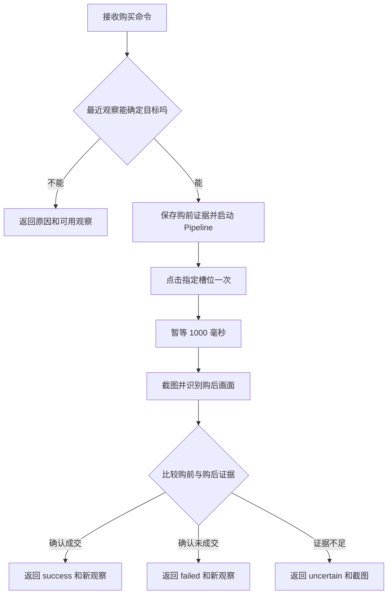

# 单次购买流程

草案命令为 `cw buy shop_1`。服务从最近一次观察读取目标和购买前的金币等证据。没有可用观察或目标不明确时，返回原因，不发送点击。

点击节点可用 `post_delay: 1000` 表达到首次购后识别的等待。这个值仅用于购买原型，需验证普通购买和升星时的画面。Python 负责结合购前证据判定结果。首次识别后能否继续等待、等待多久，需用实机样例确定。

| 购后证据（待实机验证） | 返回 |
|---|---|
| 目标格出现已确认的售出特征，且金币变化符合实际价格 | `success`，同时报告可靠识别到的角色变化 |
| 游戏明确拒绝购买，且证据能确认未成交 | `failed`，附原因和新观察 |
| 画面仍在过渡、出现未知弹窗，或成交证据缺失或冲突 | `uncertain`，附能确认的观察和截图 |

一个命令最多发出一次购买点击。出现需要玩家选择的界面时，返回当前观察，由 AI 决定下一条命令。
