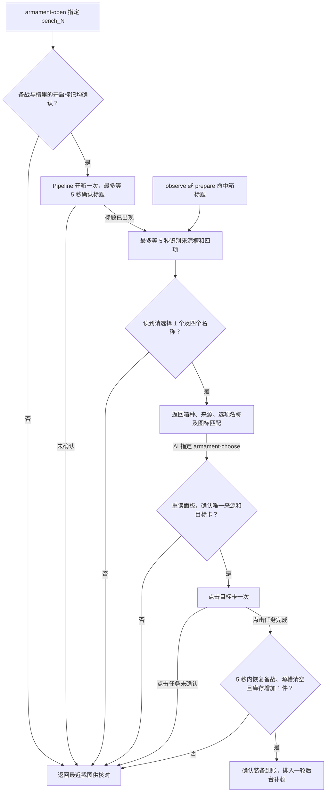

# 武装箱

适用 1920×1080 的商店收起布局。备战席上的「开启」按槽检测，槽位结果用 `kind: "armament"` 表示，仍占一个备战席位置。右侧是「选择主角」入口时，`observe` 同时用 `armament_slots` 列出可开的箱。已有武装箱在备战席满时也可打开，见 2026-11-15 的简易箱录像。

标题模板覆盖简易箱、进阶箱和阿哈·简易武装箱。名称由 OCR 读取，来源取备战席唯一带白色横边的槽。阿哈箱选项页面识别及选择生命之花、到账已实机验证；修改后的开箱入口待实机验证。

开箱或选装备的 Pipeline 未确认时，返回 `uncertain`、最新截图及节点错误信息。本次请求结束，由调用方核对现场。

识别框沿用备战席固定槽位。箱卡下缘框住「开启」，标题框只覆盖中央箱名，四张卡各画名称框和图标裁剪框。到账检查覆盖右侧两列。库存保留右列 `c1`，左列用 `c2`。

标题阈值为 0.84，「开启」为 0.80。选项图标候选最低分和分差为 0.76 和 0.08。到账使用本次选项图标缩放到库存尺寸后匹配，阈值为 0.78。只计入对齐两列的命中，简易箱样例出现了鼠标悬停时绘制在列外的装备副本。简易箱的「光能电池」和进阶箱的「生命之环」已通过保存帧和模拟输入回放，实机输入效果待验证。
