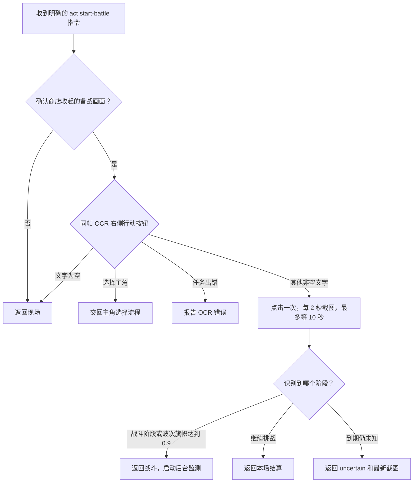
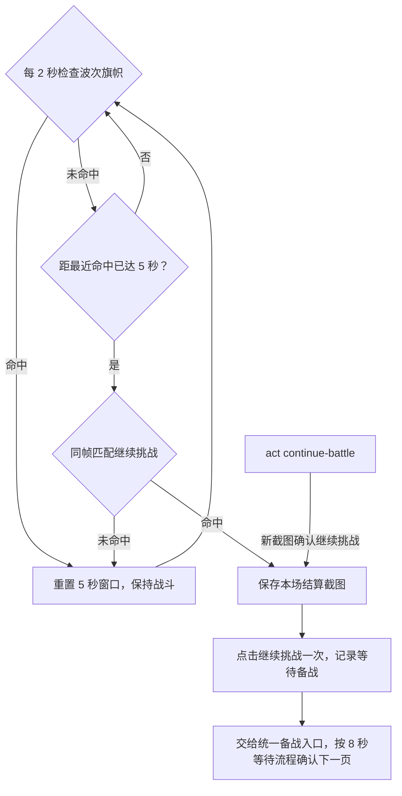

# 战斗阶段

实现在 `tools/screens/battle.py`，用 1920×1080、商店收起的出战布局。

## 入场

右侧 OCR 用 `(1700, 710, 210, 90)`，点击 `(1810, 750)`。buff 可以改变按钮文字。波次旗帜模板只含图形，波次数字另读。入场轮询末次等待用剩余时间，后台监测复用旗帜模板。

## 持续监测

末次等待用 5 秒窗口的剩余时间。技能动画遮挡旗帜时沿用已确认的战斗阶段。过场的空白点击、备战确认与收集见[统一备战入口](prepare.md#战斗收尾)。

## CLI 与生命周期

- `act start-battle` 确认入场后返回，后台监测继续。
- `status` 的两个字段分工不同：`status` 表示命令忙闲，`screen` 表示战斗模块记录的游戏阶段。
- `observe` 只读当前截图，不启动后台监测；战斗标志被遮挡时当前帧可能返回未知。已由出战启动的后台监测仍会自动收尾。
- 后台与 CLI 共用操作锁：CLI 操作时后台跳过本次截图，后台截图时其他操作返回 busy。
- 后台确认结算后串行收尾，期间 `status` 显示 busy 和等待备战；结果返回后停止后台截图，再次确认战斗时继续。停止服务时等待当前收尾步骤结束。
- 正常入口确认备战或投资策略后更新记录阶段；识别其他界面失败时保留此前阶段。
- 截图或识别出错时记录异常类型与上下文，发布 `uncertain` 并结束本次监测。

模板在初始化时加载，普通监测只读窗口截图、匹配小区域并更新内存状态。服务不主动唤醒 AI，结果由 AI 通过 `status` 或 `observe` 查询。

## 验证依据

旗帜取自用户 `pebrel-paste-CwQvO1.png`；离线匹配分数为录像战斗 0.940、实机 1/2 波次 0.999、备战 0.353、结算 0.287。节点提示与「继续挑战」文字取自 `2026-11-14 09-37-25.mp4`。

2026-11-14 提权重载后在 1-7 实机出战，约 2.9 秒返回战斗，旗帜 0.999。开大期间旗帜降至 0.182，当时的观察命令仍返回战斗。后台自行识别到结算，继续挑战 0.997。自动收尾用 `2026-11-14 11-14-29.mp4` 保存帧经 Session 入口回放，输入使用 Mock。

此前的控件方案在技能动画中只能匹配到 0.636，导致十秒超时，因此改为旗帜与节点提示确认入场，并新增旗帜隐藏后的五秒结算检查。
