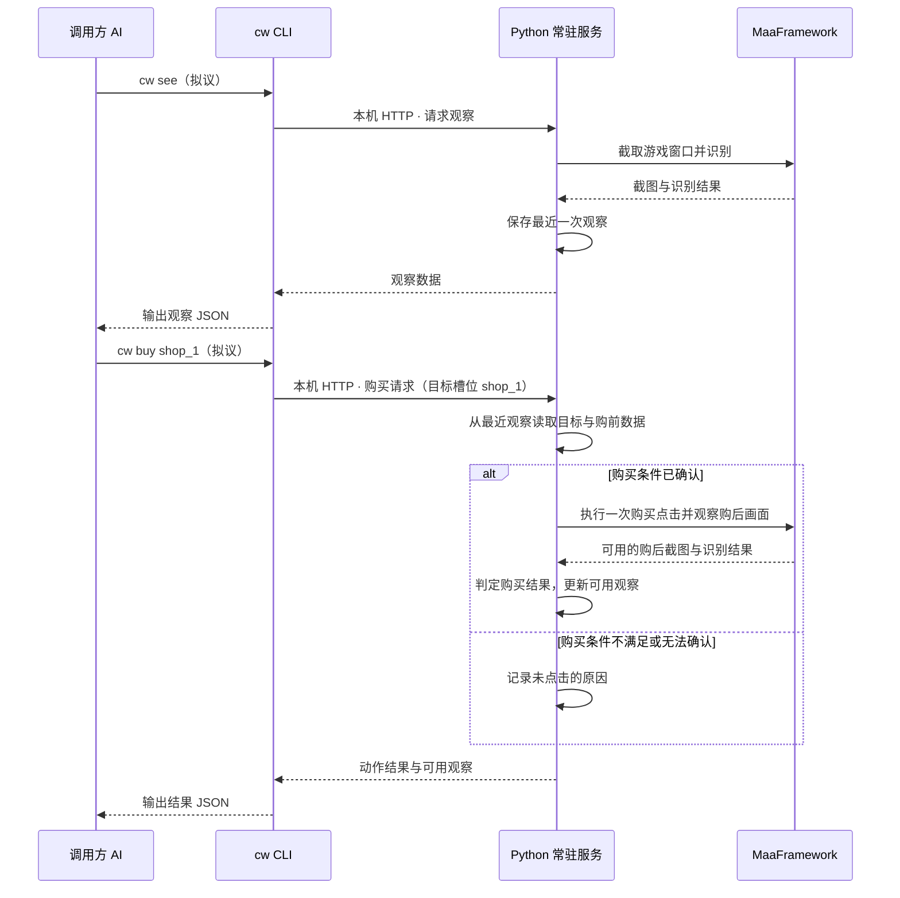
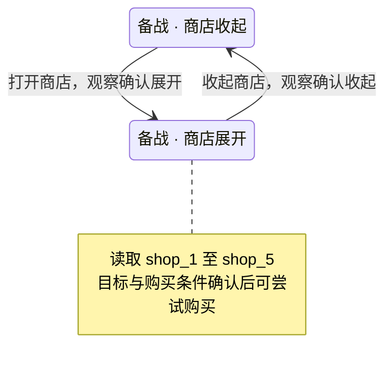
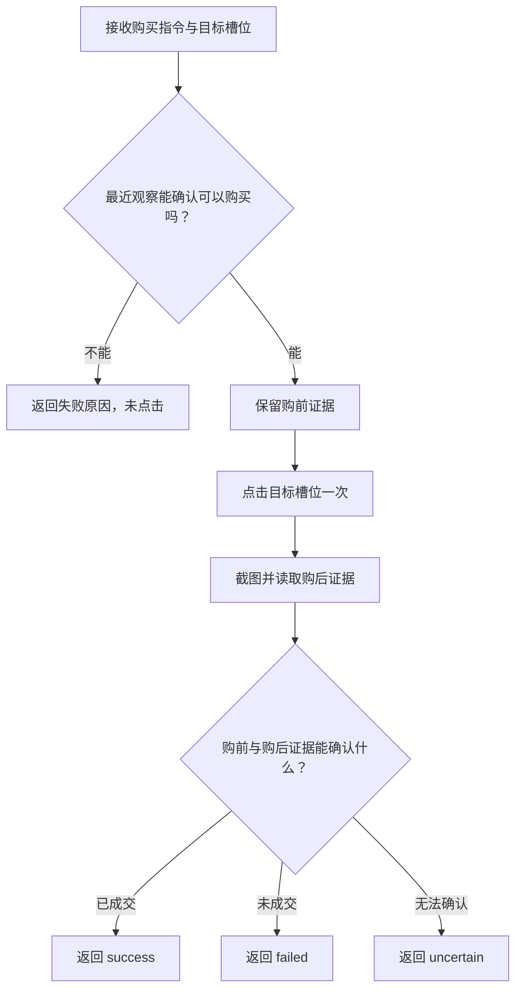

# 购买角色

调用方指定当前商店的一个槽位。服务按最近一次观察检查条件，最多点击一次，再用购前与购后的画面证据判定结果。`buy` 尚未实现。

## 命令时序

`cw see`、`cw buy shop_1` 是拟议命令；当前 CLI 用 `screenshot` 取截图，`buy` 接口待实现。



| 数据 | 流向 | 形态 |
|---|---|---|
| 购买意图 | AI → CLI → 服务 | 调用方给出目标槽位，经本机 HTTP 传给服务 |
| 游戏画面 | 窗口 → MaaFramework → 服务 | 截图存 `.runtime/screenshots/`，结构化观察拟在会话中保留 |
| 动作结果 | 服务 → CLI → AI | JSON，判定规则见下文 |

会话保留窗口连接、最近截图尺寸和操作锁，购买请求复用这份互斥边界。

## 商店展开状态

收起与展开两种布局的中央槽位位置和大小不同，箭头为预期的操作方向。



| 当前画面 | 识别依据 | 与购买的关系 |
|---|---|---|
| 商店收起 | 可见商店入口，上方无商店卡片 | 尚无可购买的商店目标，需先打开商店 |
| 商店展开 | 上方出现商店区域，入口文字变为「收起」 | 按展开布局从左到右读取 `shop_1` 至 `shop_5` |

槽位名指当前画面里的位置，具体角色以该次观察为准。购买后的界面由新观察确定。

## 单次购买流程



```text
AI：购买 shop_1 → 读取角色、价格和金币 → 保存购前信息 → 点击一次
   → 等待结果或意外弹窗 → 核对金币、目标格及角色变化 → 返回结果与最新观察
```

购买动作按指定槽位执行；刷新商店、腾位售卖由 AI 另行指定。

### 点击前检查

1. 服务在操作入口拒绝并发输入。
2. 从最近观察读取商店状态、指定格角色名称、实际价格与可用状态；没有观察或目标不明确时不点击。
3. 读取当前金币，确认价格与金币可读且足够；两者任一不明时不猜价格、不点击。
4. 检查能否接收该角色，例如位置已满或提示不可购买。位置已满时能否通过自动升星购买待实机确认，不确定时不点击，把原因交给 AI。
5. 保存购前信息：角色名称、目标商店格、实际价格、金币，以及与判定相关的角色状态；读不到的记未知，不用上次的猜测代替。

检查在输入之前失败时结果为 `failed`，说明未点击及原因，需要重新决策时设 `needs_ai: true`。

### 点击后判定

只点击一次，等待与购买有关的变化并设有限截止时间；检查的是商店格、金币或提示，不要求整屏静止。

购前金币 24、实际价格 3，则正常扣费后应为 21；金币减少只说明货币变化，不能单独证明买到了指定角色。

| 购后的可靠观察 | 结果 |
|---|---|
| 金币减少额等于购前价格，且目标格出现经确认的售出标记 | `success`，重读相关局势 |
| 上述证据成立，并观察到角色新增或升星 | `success`，一并返回新角色状态 |
| 金币有变化但商店格无法确认，或反之 | `uncertain`，保存证据后停止 |
| 金币变化与预期不符，或识别结果互相矛盾 | `uncertain`，返回实际观察 |
| 出现未知弹窗、离开预期界面或等待到期 | `uncertain`，停止后续操作，保留现场 |
| 游戏明确拒绝且能确认未成交 | `failed`，返回原因与最新观察，不自动重试 |

金币与商店格都没变化时同样返回 `uncertain`：画面可能未更新或识别失败。免费购买、折扣、返还金币等特殊效果是否存在、如何验证，需目标版本实机确认。

购买触发自动升星或额外选择时槽位可能变化，重新识别相关区域，出现玩法决策就停止交给 AI。购买已确认但后续选择待处理时结果可为 `success` 且 `needs_ai: true`。

### 返回示例

数字仅说明格式。`evidence` 记录本次判定依据，不替代最新 `slots` 观察。

```json
{
  "result": "success",
  "screen": "备战",
  "needs_ai": false,
  "action": "buy",
  "from": "shop_1",
  "message": "已确认购买藿藿。",
  "evidence": {"name": "藿藿", "price": 3, "gold_before": 24, "gold_after": 21, "shop_slot": "已售出"},
  "gold": 21,
  "slots": {"shop_1": null, "bench_1": {"unknown": true}}
}
```

`shop_1: null` 表示已确认该格为空；若游戏显示的是售出标记而非空格，按实际形态表达。`bench_1` 未识别时保持未知。无法确认成交时字段相同，`result` 为 `uncertain`、`needs_ai` 为 `true`，`message` 说明已点击与未能确认的内容；AI 先查看新观察或截图，必要时执行 `resync`。

### 原型参数

`post_delay: 1000` 设置点击到首次购后识别的等待时间；完成特征、截止时间以及普通购买与自动升星的差异随后续实机样例确定。
