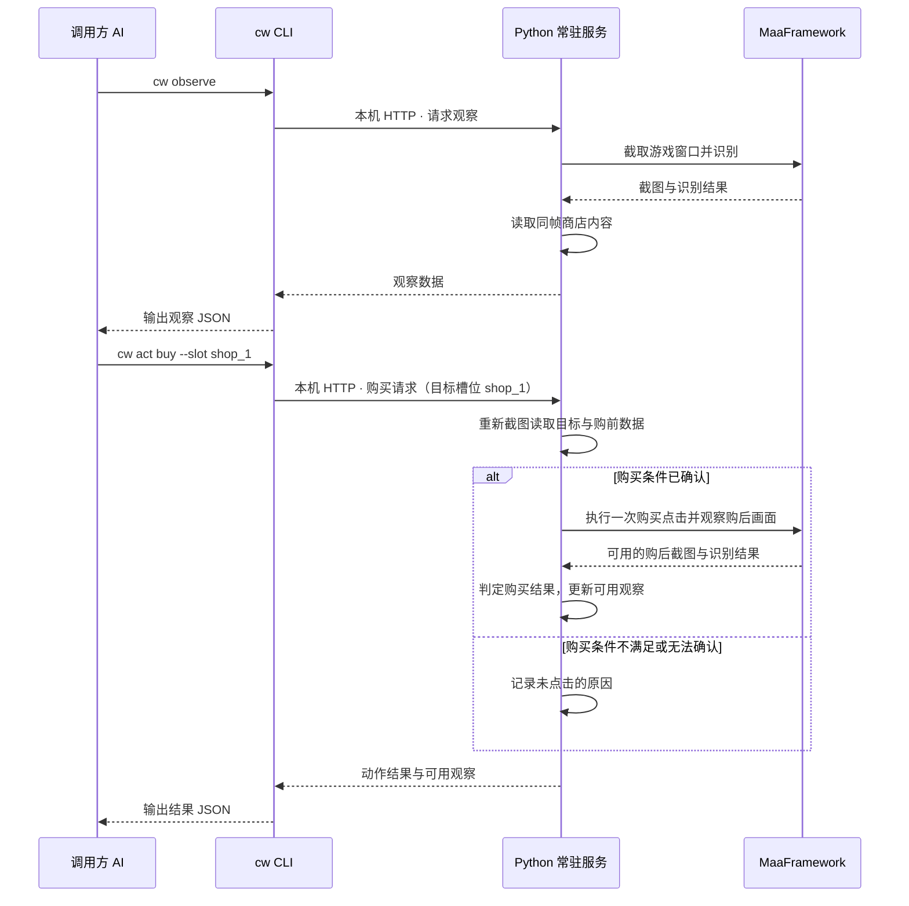
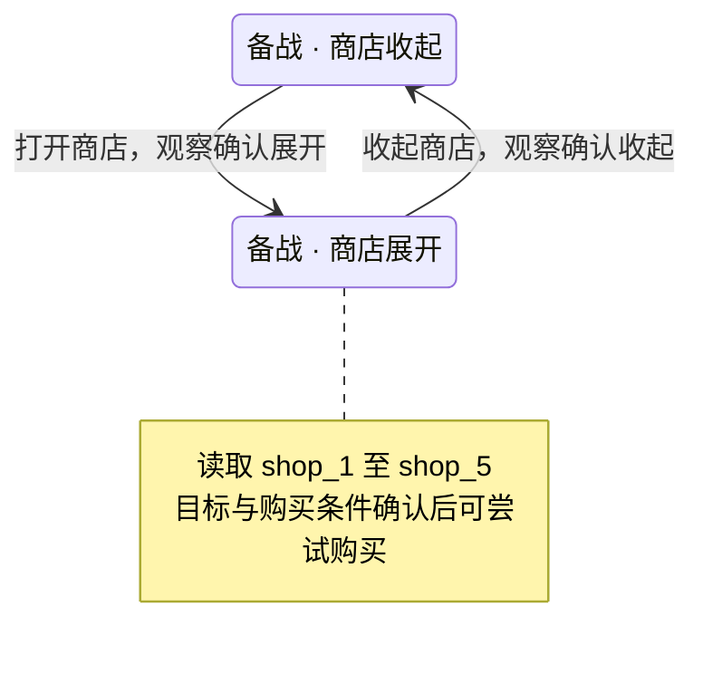
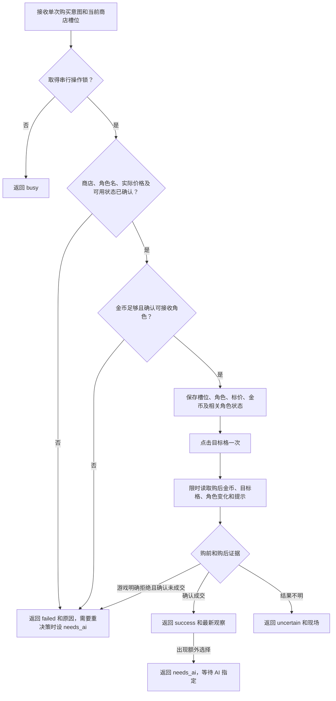

# 购买角色

调用方指定当前商店的一个槽位。服务在本次操作重新截图检查条件，最多点击一次，再用购前与购后的画面证据判定结果。

## 命令时序

通过 `observe` 查看当前商店，再用 `act buy --slot shop_3` 购买。购买入口重新读取目标，返回截图和证据。



| 数据 | 流向 | 形态 |
|---|---|---|
| 购买意图 | AI → CLI → 服务 | 调用方给出目标槽位，经本机 HTTP 传给服务 |
| 游戏画面 | 窗口 → MaaFramework → 服务 | 截图存 `.runtime/screenshots/`，本次动作读取同帧状态 |
| 动作结果 | 服务 → CLI → AI | JSON，判定规则见下文 |

会话保留窗口连接、最近截图尺寸和操作锁，购买请求复用这份互斥边界。

## 商店展开状态

收起与展开两种布局的中央槽位位置和大小不同，箭头为预期的操作方向。



| 当前画面 | 识别依据 | 与购买的关系 |
|---|---|---|
| 商店收起 | 可见商店入口，上方无商店卡片 | 尚无可购买的商店目标，需先打开商店 |
| 商店展开 | 上方出现商店区域，入口文字变为「收起」 | 按展开布局从左到右读取 `shop_1` 至 `shop_5` |

槽位名指当前画面里的位置，具体角色以该次观察为准。购买后的界面由新观察确定。

商店展开时，`observe`、`act shop-open` 和确认成功的 `act refresh` 从返回截图中读取五格商店，槽位名从左至右为 `shop_1` 至 `shop_5`。

| 字段 | 内容 |
|---|---|
| `shop_slots` | 每格卡底名称。空位或名字未读到时为 `null` |
| `shop_stars` | 角色星级。卡顶成行的金色星标按颗数计，名单内角色无成组星标时按一星返回。其他槽位为 `null` |
| `shop_empty_slots` | 与购买后空位图案匹配的槽位列表。匹配后跳过该格的名字和星级读取 |
| `shop_goods` | 角色名单外的非空槽位。每项返回 `kind`、`name`、`price` 和 `description` |

卡底名称未匹配角色名单时，对该槽做整卡 OCR，并单独读右下角价格。整卡读到角色名后按角色处理。装备使用卡中央的方框模板确认，类型为 `equipment`。从卡面左侧起排的效果正文按从上到下拼接，类型为 `effect`。类型暂未确认时返回 `unknown`，保留已读到的名称和价格。已见装备「以太钻头」售价 4，效果商品「肖像速写」售价 3，卡面说明为「获得1个【员工投影仪】。」。

装备图标右下角带欢愉面具时额外返回 `equip_target: "aha"`，表示只能装到备战区左上的阿哈装备栏。同名装备通过标记区分，阿哈版按[阿哈装备栏](equipment-synthesis.md#阿哈装备栏)的规则处理。

1-3 的买前截图中，商店第 2 格景元和第 3 格刻律德菈均有两颗星。买后第 3 格显示中央空位图案，备战席出现二星刻律德菈。刷新检查只读金币、费用和次数，确认刷新后才读取新卡。

## 单次购买流程



刷新和腾位售卖由 AI 另行指定。满席时能否通过自动升星购买待实机确认，当前要求备战席至少有一个已确认的空位。售价或金币未读出时返回 `uncertain`；未识别角色、已售空或非角色商品返回 `failed`。免费购买待样例确认。

### 点击后判定

只点击一次，等待与购买有关的变化并设有限截止时间；检查的是商店格、金币或提示，不要求整屏静止。

购前金币 24、实际价格 3，则正常扣费后应为 21；金币减少只说明货币变化，不能单独证明买到了指定角色。

| 购后的可靠观察 | 结果 |
|---|---|
| 金币减少额等于购前价格，且目标格出现经确认的售出标记 | `success`，重读相关局势 |
| 上述证据成立，并观察到角色新增或升星 | `success`，一并返回新角色状态 |
| 金币有变化但商店格无法确认，或反之 | `uncertain`，保存证据后停止 |
| 金币变化与预期不符，或识别结果互相矛盾 | `uncertain`，返回实际观察 |
| 出现未知弹窗、离开预期界面或等待到期 | `uncertain`，停止后续操作，保留现场 |
| 游戏明确拒绝且能确认未成交 | `failed`，返回原因与最新观察，不自动重试 |
| 购前卡面在点击时已与截图不一致，Pipeline 未发出点击 | `failed`，说明未发送输入，不进入购后等待 |

金币与商店格都没变化时同样返回 `uncertain`：画面可能未更新或识别失败。免费购买、折扣、返还金币等特殊效果是否存在、如何验证，需目标版本实机确认。

购买后若出现额外界面，当前停止并返回现场 `uncertain`；该情况下的成交与后续选择待核对。当前成功结果重读商店，不读取展开布局下的前后台角色。

### 返回示例

数字仅说明格式。`evidence` 记录本次判定依据；成功时返回商店状态。

```json
{
  "result": "success",
  "screen": "备战",
  "needs_ai": false,
  "action": "buy",
  "slot": "shop_1",
  "message": "已确认购买藿藿。",
  "evidence": {"name": "藿藿", "price": 3, "gold_before": 24, "gold_after": 21, "shop_slot_empty": true},
  "gold": 21,
  "shop_slots": {"shop_1": null},
  "shop_empty_slots": ["shop_1"]
}
```

`shop_empty_slots` 表示已确认售空的格子。无法确认成交时返回 `uncertain`、`needs_ai: true`、证据与截图；AI 先查看现场，必要时执行 `resync`。

### 原型参数

短 Pipeline 以购前卡面为点击条件，点击后等待 1 秒，再最多等 5 秒识别售空格；随后最多等 8 秒核对金币与售空格。卡面锁定区与裁剪区取同一矩形，卡片被替换或仍处于动画时匹配不到，此时节点没有动作，按「未发送点击」返回 `failed`。未确认时保留 Pipeline 节点及最后截图，不重发点击。以 1-3 实机购买前后帧和模拟输入回放验证了售价 3、金币 20→17、目标格变空，遮掉目标卡面后不发送点击；封装命令的游戏内输入待验证。
