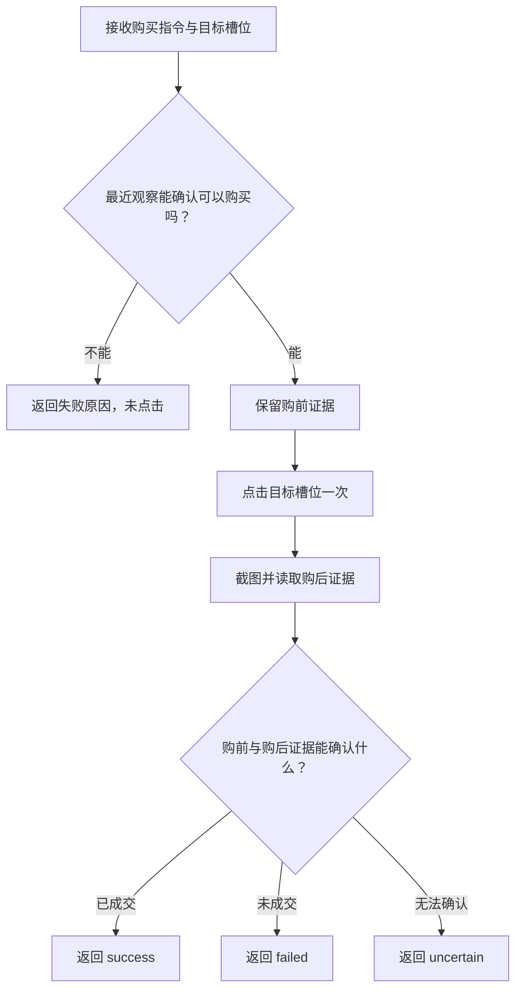

# 单次购买流程

调用方指定当前商店的一个槽位。服务根据最近一次观察检查购买条件，最多点击一次，再用购前和购后的画面证据判断结果。以下为设计草案，`buy` 尚未实现。

### 数据与判定规则

| 阶段 | 要读取的数据 | 用途 |
|---|---|---|
| 购前检查 | 商店状态、指定格的角色和可用状态、实际价格、当前金币、能否接收该角色 | 商店未确认展开、目标不明确，或其他购买条件无法确认时，结束本次动作。备战席已满时能否通过自动升星购买，待实机确认。 |
| 购后核对 | 目标格的变化、金币变化、明确的拒绝提示 | 对比同一次购买的购前记录，确认是否成交。 |
| 结果补充 | 能可靠识别的角色新增、升星或待选择界面 | 随结果返回，供调用方决定下一步。 |

| 发生阶段 | 可确认的证据 | 结果 |
|---|---|---|
| 点击前 | 购买条件不满足或无法确认 | `failed`，说明未点击及原因，有可用观察时一并返回。 |
| 点击后 | 目标格出现经验证的售出特征，且购前金币减购后金币等于实际价格 | `success`。可靠识别到新增角色或升星时，一并返回。 |
| 点击后 | 游戏明确拒绝，且能确认未成交 | `failed`，返回原因和可用观察。 |
| 点击后 | 证据缺失或冲突、画面仍在过渡，或无法确认未知弹窗出现前是否成交 | `uncertain`，返回可用观察和截图。金币和槽位看起来都没变，也归入无法确认。 |

点击后出现需要玩家选择的界面时，保留当前观察并把选择交给调用方。购买结果仍按表中证据判定。一次命令最多发出一次购买点击。

### 实机验证

原型可用 `post_delay: 1000` 设置点击到**首次购后识别**的等待时间。购买完成的画面特征、识别截止时间，以及普通购买和自动升星的差异，均待实机验证。完整业务规则见[项目设计](../../README.md#83-购买角色详细设计草案)。
