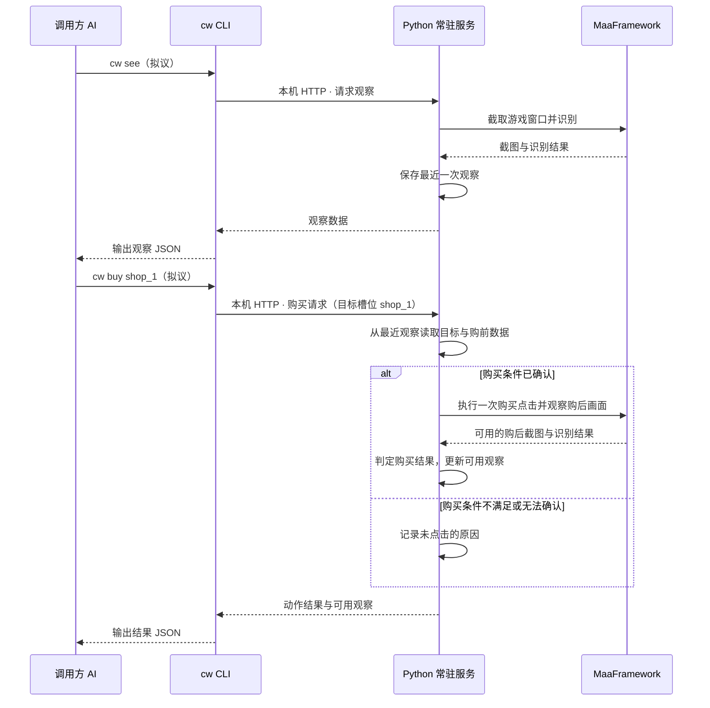

# 购买命令的 CLI 与服务时序

这张图说明一条购买指令怎样从调用方走到游戏窗口，再把结果送回去。`cw see` 和 `cw buy shop_1` 都是拟议命令；当前 CLI 用 `screenshot` 获取截图。

| 数据 | 从哪来、到哪去 | 形式与状态 |
|---|---|---|
| 购买意图 | AI → CLI → 服务 | 调用方给出目标槽位。CLI 经本机 HTTP 把购买请求传给服务，购买接口仍为草案。 |
| 游戏画面 | 游戏窗口 → MaaFramework → 服务 | 当前截图以 PNG 存到 `.runtime/screenshots/`。结构化观察拟在服务会话中保留。 |
| 动作结果 | 服务 → CLI → AI | CLI 输出 JSON。购买返回值的判定见[单次购买流程](buy.md)。 |

当前会话保留窗口连接、最近截图的尺寸和操作锁，由服务串行处理游戏输入。本图从服务接受请求开始展开购买，串行互斥沿用现有的会话边界。

常驻服务让不同 CLI 进程复用同一窗口连接；接入 Pipeline 后，也可复用识别资源、任务执行器和结构化观察。如果改为常驻的交互式 CLI，同样的会话状态可以由 CLI 进程持有。
