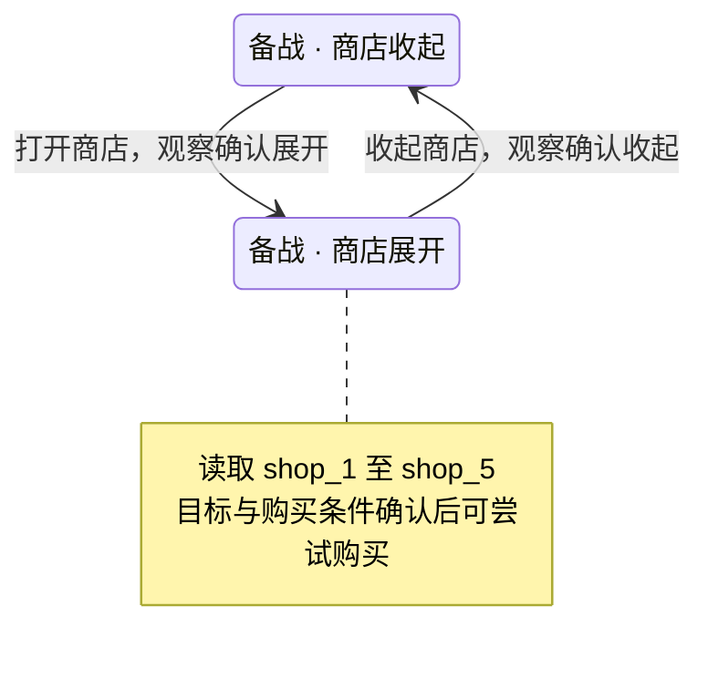

# 备战与商店状态

用户提供的截图显示，商店收起和展开时，中央槽位的位置与大小不同。下图描述这两种已观察到的布局；箭头表示预期的操作方向，转换完成特征仍待实机确认。

| 当前画面 | 识别依据 | 与购买的关系 |
|---|---|---|
| 商店收起 | 样例中可见商店入口，未展示上方商店卡片。 | 尚无可用的商店目标，需先打开商店再观察。 |
| 商店展开 | 样例中上方出现商店区域，入口文字变为「收起」。 | 用展开布局从左到右读取 `shop_1` 至 `shop_5`。槽位名指当前画面里的位置，具体角色以该次观察为准。 |

购买后的界面由新观察确定。过渡画面、弹窗和自动升星的表现仍待实机确认。识别不到布局时，记录为未确认；[购买流程](buy.md)据此决定是否能执行点击。
