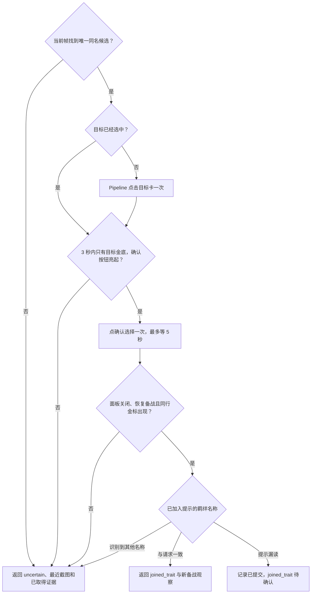

# 双龙吟羁绊选择

丹恒•饮月上阵会触发「双龙吟」，面板提示「请选择一个羁绊加入」。3-4 录像从面板已经打开开始，四张候选从左到右为召唤、治疗、连击、反击。录像中可以先选召唤、改选治疗，再改选连击，最后单独点击「确认选择」。

## 观察和动作入口

`observe` 先匹配上方弹窗标题，返回 `screen: "双龙吟"`、`options`、`selected_trait`、`can_confirm` 和同帧截图。`options` 按从左到右返回，每项包含 `slot`（如 `option_3`）和 `trait`（如「连击」）。候选名通过文字区域读取，现有羁绊表可用于向 AI 提供候选的档位信息。角色拖动后若识别到面板，在动作结果里一并返回选择状态。录像未录到上阵瞬间，仍需验证触发延迟和重复上阵时的表现。

面板识别接入备战分流，先于普通备战判定。弹窗仍在时，`prepare` 停在选择状态，后台补领保持挂起，备战操作按同一分流停在入口。确认后恢复原有备战或补领进度。

拟议命令为 `act double-dragons --trait 连击`。由 AI 指定羁绊名称，程序在当前截图读取候选并定位唯一同名卡。读取不全或找不到唯一候选时，返回现场供核对。

## 选中、确认和完成核对

选中色取卡面内部两条色带。录像 13.00 秒同时出现「连击」金底和「反击」悬停白边。提交提示的文字框按从左到右拼接。左侧金标随「双龙吟」所在行定位，确认前后该行均显示 `1/2`。

当前原生羁绊与星徽的阵容推算可以继续返回。选中的羁绊通过操作结果提供给 AI。录像能确认「连击」出现在左侧列表以及提交提示出现。具体计入哪些角色、换位或下阵后如何保留、能否重新选择，等相应画面确认后再计入 `trait_projection`。

## 识别框

坐标使用 1920×1080 原图的 `(x, y, 宽, 高)`。

| 区域 | 坐标和用途 |
|---|---|
| 弹窗标题 | `(975, 52, 145, 49)`，匹配「双龙吟」 |
| 选择说明 | `(922, 115, 250, 40)`，读取「请选择一个羁绊加入」 |
| 候选名称 | 卡片左边 `x = 576、816、1056、1296`，各读 `(x+29, 330, 162, 42)` |
| 选中金底 | 各卡取 `(x+10, 205, 24, 87)` 与 `(x+188, 205, 24, 87)` 两条色带，点击卡片中部 |
| 确认按钮 | `(1375, 576, 235, 43)` 取内部亮色占比，按钮中心约 `(1490, 597)` |
| 提交提示 | `(808, 178, 320, 46)`，在过场中短时读取 |
| 左侧完成标志 | 在 `(102, 228, 147, 542)` 内识别「双龙吟」所在行，按行名文字框偏移找金标。样例搜索框为 `(175, 237, 54, 50)` |

离线试读中，标题匹配在弹窗稳定帧为 0.998～1.000，弹窗闭合后为 0.19～0.22，简易和进阶武装箱对照帧均低于 0.25。金色色带在选中卡约 98%，深色卡和仅悬停卡为 0%。确认按钮内部亮色比例约 90%，未选状态为 0%。左侧金标匹配在确认前为 0，确认后约 1.00。实现可用标题和金标阈值 0.88、金色和亮色比例 60% 开始回放验证。试读金色采样用 RGB 条件 `R > 175`、`G > 145`、`R − B > 45`、`G − B > 30`，按钮亮色用三个通道均大于 200。

## 样例与待确认

- 录像 `2026-11-19 17-47-59.mp4` 约 9.50 秒选中召唤，11.75 秒改选治疗，12.50 秒改选连击。
- 约 20.50 秒回到备战且左侧出现完成金标，21.25～22.75 秒读到「已加入：【连击】羁绊」，23 秒以后金标仍可见。采样间隔为 0.25 秒。
- 原尺寸关键帧和识别框标注在 `tools/.runtime/double-dragons/`。当前为设计与离线验证，待补上阵触发、其他候选或行位置、退出与重新上阵的录像样例。
