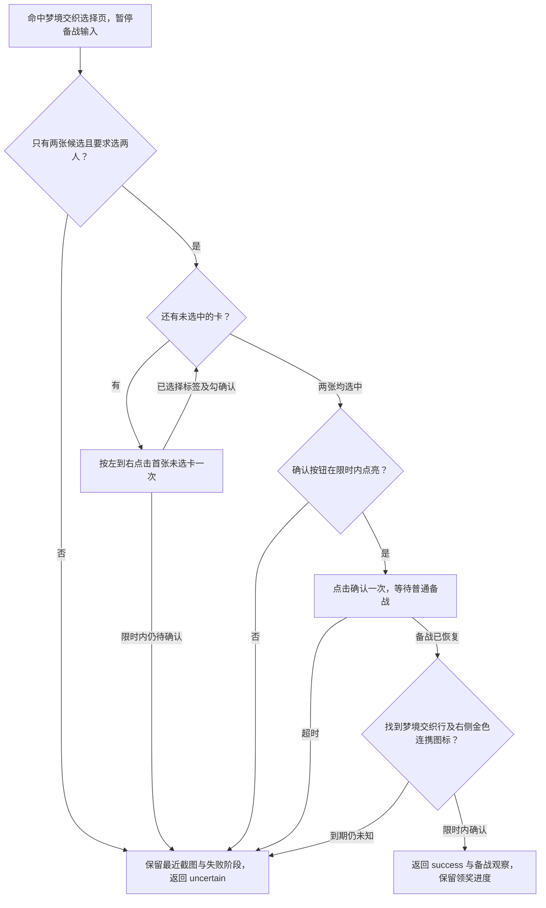

# 梦境交织共舞选择

当前为设计。2-2 备战实机给前台那刻夏穿上「梦境交织星徽」后，左侧「梦境交织」显示 2 档，游戏弹出同名选择面板。录像从面板已打开开始。面板要求选两名角色，为他们增加战斗内连携效果。本次候选为花火与那刻夏。

## 观察与分流

`observe` 先识别上方紫色面板内的「梦境交织」标题 `(955, 55, 180, 43)`，画面按 1920×1080。左侧同名羁绊和仍然可见的备战控件不用于识别弹窗。识别到面板后，只读返回 `screen: "梦境交织"`、当前选中状态及同帧截图。

首版确认面板要求选两人且只有左右两张候选卡时自动处理。卡片左上「已选择」标签和右上勾选图标共同确认选中。悬停时也有白边，白边不能作为选中依据。「确认选择」按钮变亮才算可用，按钮有文字时也可能是灰色禁用状态。

`prepare` 和战后入场识别到该弹窗后先暂停空白点击、收商店和领奖，交由共舞 Pipeline 处理。后台补领遇到弹窗时挂起，等待备战恢复。未来穿戴动作触发弹窗时可在同一操作内调用这段 Pipeline。

## 自动选择并确认

已选卡跳过点击。各节点等待设有限超时。

## 左侧羁绊核对

本次只设计「梦境交织」这一行的核对。1920×1080 样例可在 `(106, 229, 153, 538)` 内识别名称及文字框。精确找到「梦境交织」后，以文字框的纵坐标为基准，在该行右侧的小范围匹配金色连携图标，行号由画面决定。录像显示羁绊人数在确认前后都是 2，金色图标只在确认后出现。因此人数和档位不作为完成证据。候选姓名及角色卡上的图标也不参与核对。

离线用确认后的图标裁区试匹配，确认前两帧约 0.35，确认后两帧为 1.00。匹配阈值仍待其他位置和画面样例确认。行定位复用[备战羁绊识别](traits.md)，共舞确认只核对金色图标。

## 录像依据与待确认

| 时间 | 画面证据 |
|---|---|
| 0.50 秒 | 两张候选均未选中，确认按钮灰色，并提示「请选择2名共舞的角色」 |
| 2.50 秒 | 那刻夏仅悬停变白边，无「已选择」和勾 |
| 3.80 秒 | 那刻夏已选中，确认按钮仍灰色 |
| 7.50 至 8.75 秒 | 花火、那刻夏均已选中，按钮变亮，红色提示消失 |
| 10.00 至 13.00 秒 | 回到 2-2 备战，两张前台角色卡左上出现连携标记，左侧羁绊旁也出现连携图标 |

原录像为 `2026-11-18 19-33-14.mp4`。原尺寸关键帧保存在 `tools/.runtime/dreamweave-design/`，已用现有 OCR 核对标题和两张候选姓名。待确认的情况包括更高羁绊档位的候选数和布局、能否改选或重新打开、调整阵容后连携怎样变化，以及同名候选能否在画面上区分。以上情况需实际画面再定。
