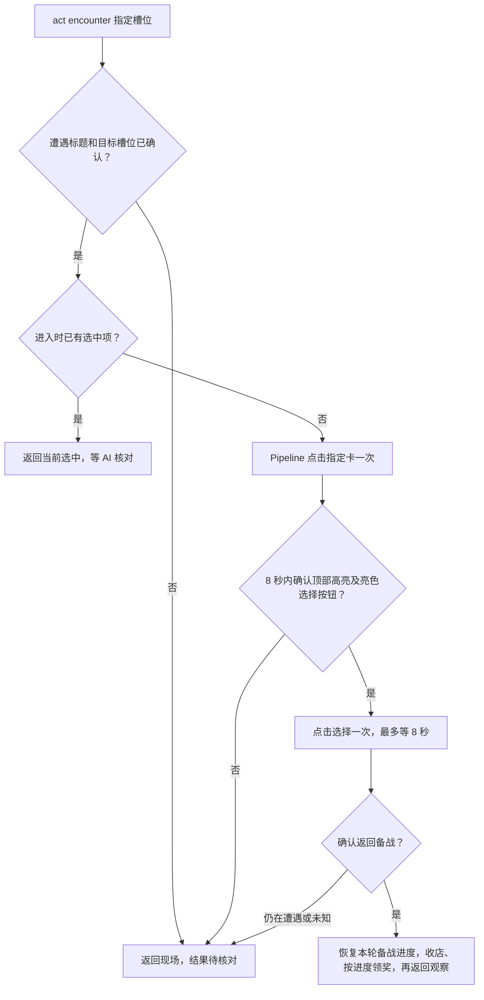
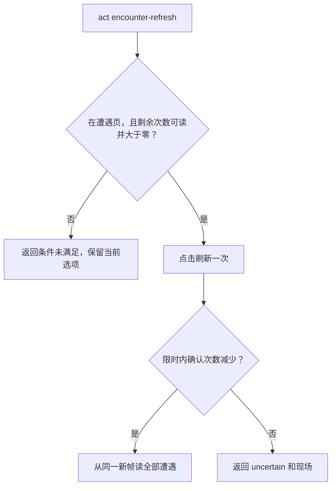

# 遭遇节点

本页覆盖已实现的两项遭遇布局。依据用户提供的 1920×1080 截图、难度与刷新说明，以及一次实际选择。遭遇的风险与收益由 AI 判断，程序不自行选难度或刷新。

## 命令

```powershell
.\.venv\Scripts\python.exe tools/cw.py observe
.\.venv\Scripts\python.exe tools/cw.py act encounter --option 2
.\.venv\Scripts\python.exe tools/cw.py act encounter-refresh
```

`observe` 只读当前页；选项按画面从左到右编号，编号指位置，与难度无关。选择和刷新各由 AI 明确指定，游戏输入与其他操作串行。

## 识别与返回

以页面标题「遭遇节点」定位，按卡片区域读取每项的标题、奖励文字与数量。用户说明「遭遇其一／其三」中的数字表示难度：分别返回数值 1、3，同时保留原文；不能读清时难度为 `null`，不依据颜色或位置猜测。数量位于奖励图标角落，能确认时返回数字，否则为 `null`；奖励名称保留画面原文，不把图标或未知内容猜成已知奖励。

返回同一帧截图、`screen: "遭遇"`、`needs_ai: true`、各选项的 `slot`、`title`、`difficulty`、`reward`（文字和数量）以及剩余刷新次数 `refreshes_left`。识别不全时保留可读信息，返回 `uncertain`。当前实现固定读取两项，左侧「遭遇其一」预览金币 2，右侧「遭遇其三」预览随机4费角色 2，刷新剩余 1 次；其他数量、布局与奖励形式待样例确认。

未读全只依据难度和奖励文字判断：装备类奖励本来没有数量数字（1-7 实机「光能电池」），数量为 `null` 不算未读全，否则 `act encounter` 会一直等到超时。

战后等待和备战入口发现遭遇页时立即停止空白点击、收商店和领奖，将选项交给 AI。后台补领在遭遇页暂停；选择完成后按实际后续页面恢复本轮备战流程，不重复已经完成的领取。

## 选择



实测右侧「遭遇其三」返回 1-7、商店展开、右侧显示「出战」。出战等待 AI 指令，改选交互待验证。

## 刷新



刷新同时更换全部选项，成交依据是次数减少。刷新后出现相同选项、额外确认或按钮缺失的情形待实机验证。

## 实测与待确认

2026-11-17：未选中时「选择」为灰色；点击右卡后边框高亮、按钮变亮并出现「查看详情」；点击「选择」后返回 1-7 备战、商店展开。三张现场保存在 `tools/.runtime/encounter-design/`。离线识别两项奖励与右侧选中状态正确，短 Pipeline 用离线帧和模拟输入回放通过；左侧选中样式、游戏内 Pipeline 和刷新待实机验证。奖励是否以及何时到账、详情入口内容、刷新后的选中状态和其他布局待确认。
