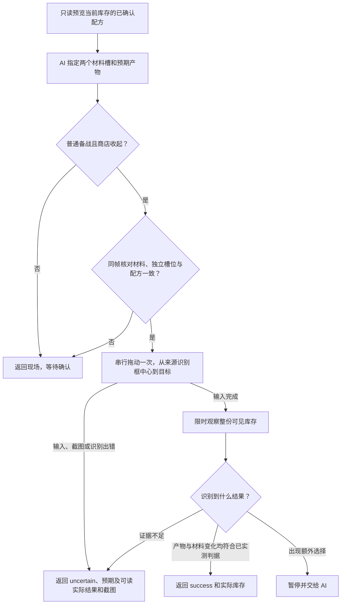

# 装备合成

本页是设计，尚未实现。根据用户说明，备战右侧装备区可将一件装备拖到另一件装备上合成。AI 在决定合成前应知道两件材料和预期产物；程序负责读取、展示已确认的配方，执行 AI 指定的一次拖动并核对结果。

## 配方与合成预览

装备素材文件目前只提供图标及 ID，不包含合成关系或效果，不能从文件名、图标相似度或一次拖动结果推断完整配方。需要先收集当前版本的游戏内配方信息和实际合成样例，将已核对的材料、产物及可读效果保存为独立数据，并记录来源和适用版本；游戏内是否存在可直接读取的完整配方页面待确认。配方是否无序、相同材料能否合成、同一材料组合是否只有一个结果，均以样例为准，不预设。

拟提供只读预览：基于一次库存观察列出有明确配方的材料槽位组合，返回两件材料 ID、槽位、预期产物 ID、名称与已知效果，供 AI 选择。只提供单个材料组合时，也可查询其预期产物。以下是字段示意，不代表真实配方：

```json
{
  "from": "bag_r1_c1",
  "to": "bag_r2_c1",
  "materials": ["material_a", "material_b"],
  "result": {"id": "product_c", "name": "示例装备", "effect": "示例效果"}
}
```

识别未知、配方缺失或存在歧义时明确返回未知和已有候选，不承诺产物、不执行合成。库存位置可能因操作变化而重排，预览只描述当时的画面；执行前须重新观察，不把旧槽位当作物品实例。

## 执行一次合成

拟定 `act synthesize --from bag_r1_c1 --to bag_r2_c1`，调用方还须给出预期产物 ID，使执行前可以核对当前槽位与预览所对应的配方。参数名称和配方查询接口可在实现时确定。



验证以整个可识别库存的实际变化为依据，不假定产物一定留在目标槽位，也不沿用合成前的槽位映射。合成消耗数量、产物落点、库存重排及动画时序需要实机样例，确认后再确定成功判据；缺少足够证据时不能把拖动成功当作合成成功。

## 当前范围与待确认

现有库存识别仅覆盖右侧最右一列，未定位时返回 `null`；多列、空格和数量表现尚未验证。因此预览与执行的第一版只能基于确认可读取的库存，不能声称覆盖全部物品。装备名称、效果及配方数据也尚未接入。需要配方页面或其他可信资料，以及至少一次拖动前、拖动中和完成后的真实画面，才能定下识别范围、操作时序和验证规则。
