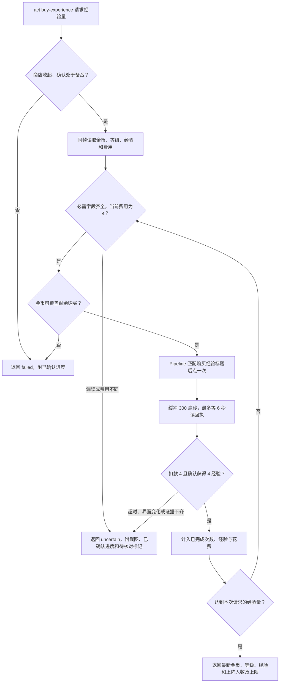

# 购买经验

命令为 `act buy-experience --xp N`。`N` 是本次要购买的经验量，须为正整数且为 4 的倍数。每次花 4 金币获得 4 经验，`--xp 12` 对应 3 次购买，预算为 12 金币。AI 根据当前局势决定数量。

## 购买流程

操作在串行锁内执行。后续点击复用最近确认帧。未到升级线时，确认等级和该级经验需求相同、当前经验增加 4。未确认的一笔通过 `purchase_pending` 标记，已确认花费单独累计。

回执等待为 6 秒：1-6 实机升 5 级时，等级条跳动和金币数字滚动持续超过 3 秒，3 秒窗口内连续读数都拿不到金币。经验费用只在首笔前核对一次，后续笔的金币减少额由 `received` 逐笔确认，避免按钮点击后的高亮动画把费用读空而中断整批。

## 跨级和满级

跨一级时，确认扣款 4，检查等级变化以及新等级的经验进度。当前用「旧等级剩余经验 + 新等级当前经验 = 4」核对跨级这一笔。例：旧等级为 `2/4`，购买后升一级并显示新等级当前经验 `2`。

跨级经验是否结转、满级时的按钮样式、到顶时剩余经验如何处理，等购买前后同一场实机截图确认。若跨级后读数与结转判据不符，或下一笔的费用和经验进度读不到，返回已确认进度。

## 返回字段

| 字段 | 含义 |
|---|---|
| `xp_requested` | AI 请求购买的经验 |
| `xp_bought`、`purchases_confirmed`、`gold_spent` | 已确认获得的经验、次数和金币支出 |
| `purchase_pending` | 最近一次点击已发出或发送状态待确认，效果尚未核对 |
| `gold`、`level`、`experience`、`experience_cost`、`deployment` | 最近一帧可读到的状态，缺失字段沿用备战观察的空值约定 |
| `screenshot` | 对应状态截图 |

现有 OCR 已在 1-1、1-2 和 3-7 的保存帧读出等级、当前经验、升级所需经验、单次费用和上阵人数。3-7 的 `Lv.8`、`4/72`、费用 `4`、上阵 `9/9` 均识别成功。金币框移至 `(1618, 897, 73, 48)` 后，同帧金币 `132` 已读全。购买操作已通过模拟输入验证，实机点击和跨级表现待确认。
