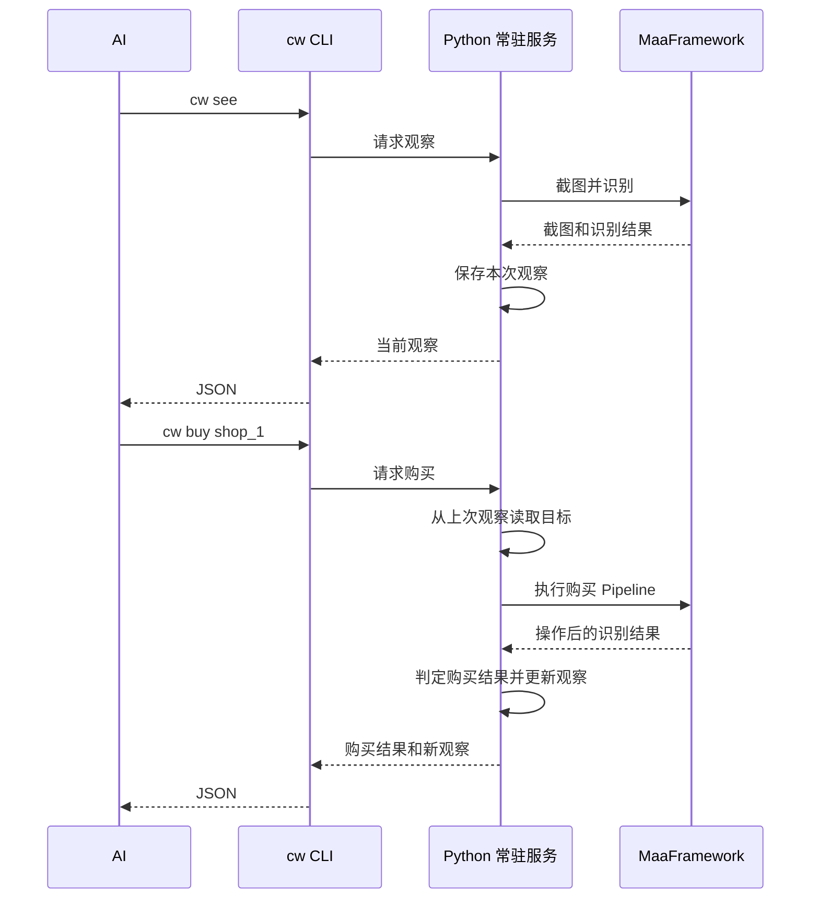

# CLI 与服务时序

一个 AI 顺序调用 CLI。服务保存最近一次观察，每个动作结束后随结果返回新观察。AI 在会话开始或需要主动重新查看时调用 `see`。

CLI 可以直接通过 Python 绑定使用 MaaFramework。一次性命令可以创建 `Controller`、连接窗口，需要运行 Pipeline 时再加载 `Resource`、绑定 `Tasker` 并提交入口。如果每次命令都启动新进程，这些对象会随进程退出。下一条命令需要重新初始化，并且要从文件读取上次观察或重新截图识别。

当前服务已把窗口连接、截图尺寸和操作锁保留在会话中。接入 Pipeline 后，资源、任务执行器和结构化观察也可随会话保留。常驻的价值是跨命令复用这些对象和观察。串行执行来自会话的操作边界，本机 HTTP 只负责把命令传进去。如果把 CLI 做成始终打开的交互进程，它也可以直接持有同一套对象，无需另起 HTTP 服务。
