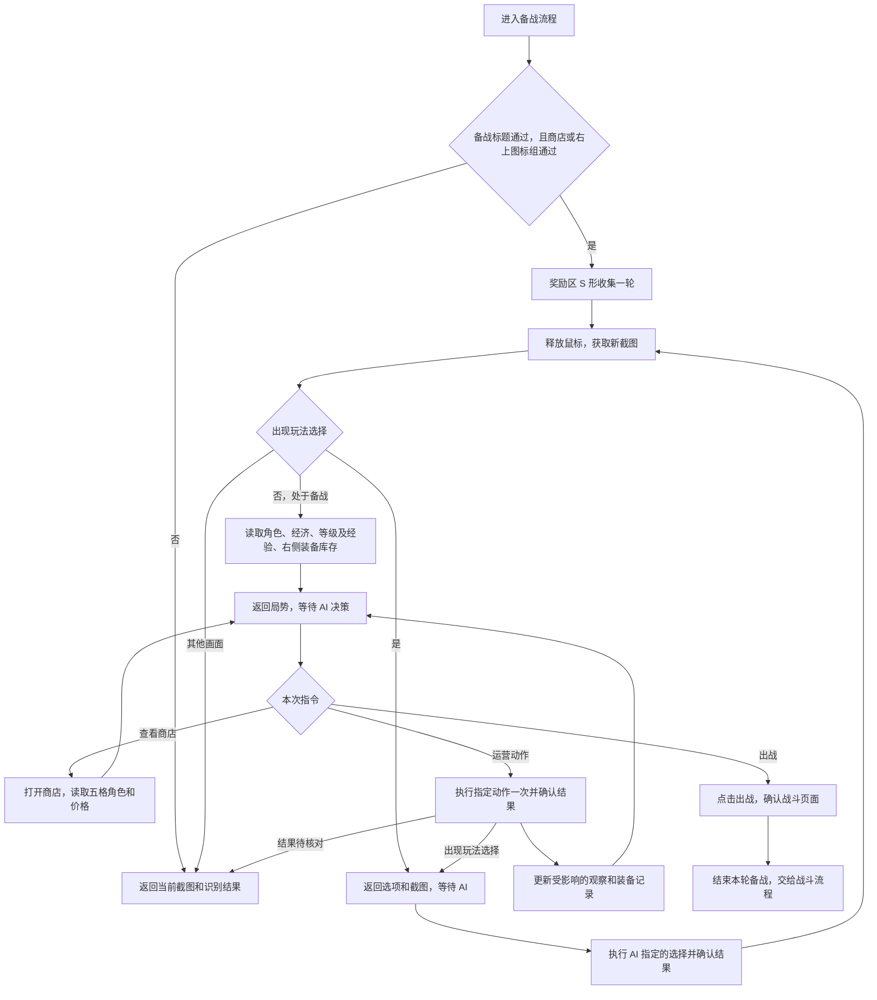

# 备战阶段

备战负责收奖励、整理局势、执行 AI 指定的运营动作，AI 决定后进入战斗。入场编排见[统一备战入口](prepare.md)，实现状态见文末。

## 执行顺序

奖励收集安排在本轮入口；选择完成或动作结束后从新画面继续，额外收集由明确指令触发。已处于选择页时从第 3 节继续。

## 1. 确认备战阶段

同一张截图，坐标依次为 `x、y、宽、高`：

- `(430, 35, 80, 23)` 的「备战阶段」匹配达到 **0.7**。
- 以下至少一项达到 **0.9**：右下「商店」`(1520, 800, 220, 260)`；右上四个图标组 `(1540, 0, 380, 110)`。

标题通过后先匹配商店，未通过再匹配图标组；只有其中一类不确认备战。

`preparation` 在本条件未通过时用同帧识别投资策略，8 秒内继续识别备战或投资策略，超时返回最后一帧与 `uncertain`，详见[投资策略](strategy.md)。`act collect` 未通过时返回 `uncertain`、分数与截图。

阶段和布局分开维护，槽位及奖励路径按 **1920×1080、商店收起**。展开商店用左上备战标题与右下「收起」共同确认，均达到 0.9；`prepare` 点击收起后等待 2 秒，最多确认 3 次，间隔 2 秒。

## 2. 收取奖励

- 从左上空白 `(12, 12)` 按下鼠标左键。
- 沿右侧奖励区 18 个折返点移动，覆盖 `x=1300～1616、y=148～460`。
- 折线按约 50 像素步距插值，共 63 个移动点，相邻间隔 20 ms。
- 一轮结束或任务出错时释放鼠标并截图。

`act collect` 返回截图及 `uncertain`，奖励变化由调用方按返回画面核对。`prepare` 用收集后的新截图确认备战或投资策略，再返回槽位或选项。

## 3. 领取后的选择和物品

出现选择框时返回标题、选项文字、可识别图标、选取数量与截图，并设 `needs_ai: true`。AI 指定选项后程序完成选择与确认，再读新画面。

容器、武装箱等物品作为当前局势的一部分交给 AI；打开、使用或选择由 AI 下指令，交互与完成特征按样例接入。

## 4. 读取领取后的局势

| 内容 | 读取范围 | 来源 |
|---|---|---|
| 角色 | 前台 4 格、后台 6 格、备战席 9 格；名称、空位、星级、已上阵数量及上限 | 当前截图 |
| 经济 | 当前金币、购买经验显示的费用 | 当前截图 |
| 等级与经验 | 当前等级、已有经验、升级所需经验 | 当前截图 |
| 右侧装备库存 | 可见的装备或道具、名称或素材 ID、界面显示的数量 | 当前截图 |
| 已穿戴装备 | 各卡片身上的已确认装备 | 穿戴和移动操作记录 |

同一帧读取并附该帧截图；已穿戴装备单独来自操作记录。

槽位沿用 `front_1`～`front_4`、`back_1`～`back_6`、`bench_1`～`bench_9`；确认的空位为 `null`，待核对为 `{"unknown": true}` 及可用候选，同名角色按槽位分别返回。`bag_N` 按当前画面可见顺序编号，领取、穿戴、使用或排序后按新画面重编。商店五格固定为 `shop_1`～`shop_5`，含角色名称与实际价格，展开布局见[购买角色](buy.md#商店展开状态)。

## 5. 维护已穿戴装备

| 操作 | 记录更新 |
|---|---|
| 穿戴 | 确认装备到达指定卡片后，更新该卡片装备栏和来源库存 |
| 移动到空位 | 确认卡片到位后，装备记录随卡片转移 |
| 两张卡片交换 | 确认后两张卡片各携带原装备记录 |
| 游戏内手动穿戴 | 调用方告知结果后补记 |
| 首次接管已有局面 | 调用方补充已穿戴装备，建立初始记录 |

记录按当前槽位区分，同名角色分别维护，普通观察复用已确认记录。自动合成、出售、拆卸和替换时的归属变化随后续动作补齐。

## 6. AI 决策与动作结果

AI 决定购买对象、刷新、购买经验、出售、站位、装备分配、道具使用和出战时机；程序逐次执行明确指令并返回确认到的结果。

| 动作 | 确认内容与观察更新 |
|---|---|
| 打开商店 | 确认展开布局，读取五格角色、价格及商店状态 |
| 购买、刷新、出售 | 核对实际金币和相关商店、角色变化；购买流程见[购买角色](buy.md#单次购买流程) |
| 购买经验 | 核对金币、经验和等级变化，更新上阵上限 |
| 移动、交换 | 核对来源与目标卡片；跨区域时更新上阵数量，装备记录随卡片更新 |
| 穿戴、使用物品 | 核对来源库存及目标变化；确认穿戴后更新装备记录 |
| 出战 | 确认进入战斗页面，结束本轮备战 |

观察按动作实际影响范围更新：购买可能触发自动合成，因此包含受影响的角色槽位。`success` 表示已确认达成目标，`failed` 表示前置条件不满足或确认未达成，`uncertain` 表示结果待核对；动作后的新选择通过 `needs_ai: true` 返回，等待 AI 期间服务空闲。

出战入口与监测见[战斗阶段](battle.md)。

## 实现状态

| 能力 | 状态 |
|---|---|
| 备战确认（标题 0.7 + 商店或图标组 0.9） | 已实现，保存帧离线核对 |
| 19 个槽位的角色名称与空位识别 | 已实现，四名角色样例通过 |
| 右侧奖励区 S 形收集 | 已实现，管理员服务实机领取过蓝色奖励球 |
| 指定槽位拖动 | 已实现，结果由调用方核对 |
| 投资策略读取、单项刷新与选择衔接 | 已实现，录像帧回放通过 |
| 主角页读取、拖选、光环选择与返回备战 | 已实现，录像帧回放通过 |
| 出战及战斗确认 | 已实现，录像帧回放通过 |
| 统一备战入口 | `prepare` 已实现确认重试、收起商店、收集与槽位观察 |
| 奖励后的选择分流 | 投资策略与主角已接入，其他选择待样例 |
| 星级、金币、等级、经验、上阵数量读取 | 未接入 |
| 右侧装备库存识别、装备记录与穿戴动作 | 未接入 |
| 商店实时观察及运营动作结果验证 | 未接入，商店名称 OCR 已有离线试验 |

接入顺序：补第 4 节观察与其他选择分流 → 跑通商店购买闭环 → 补移动验证与装备记录。

`preparation` 保持只读，`act collect` 和 `act move` 保持单动作调用；统一入口负责编排，游戏输入串行，识别复用只读上下文与 16 个工作线程。

游戏内输入与各动作的实机表现以 `PROGRESS.md` 的记录为准。
