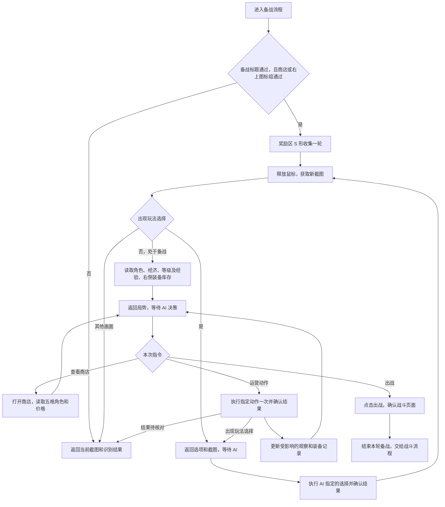
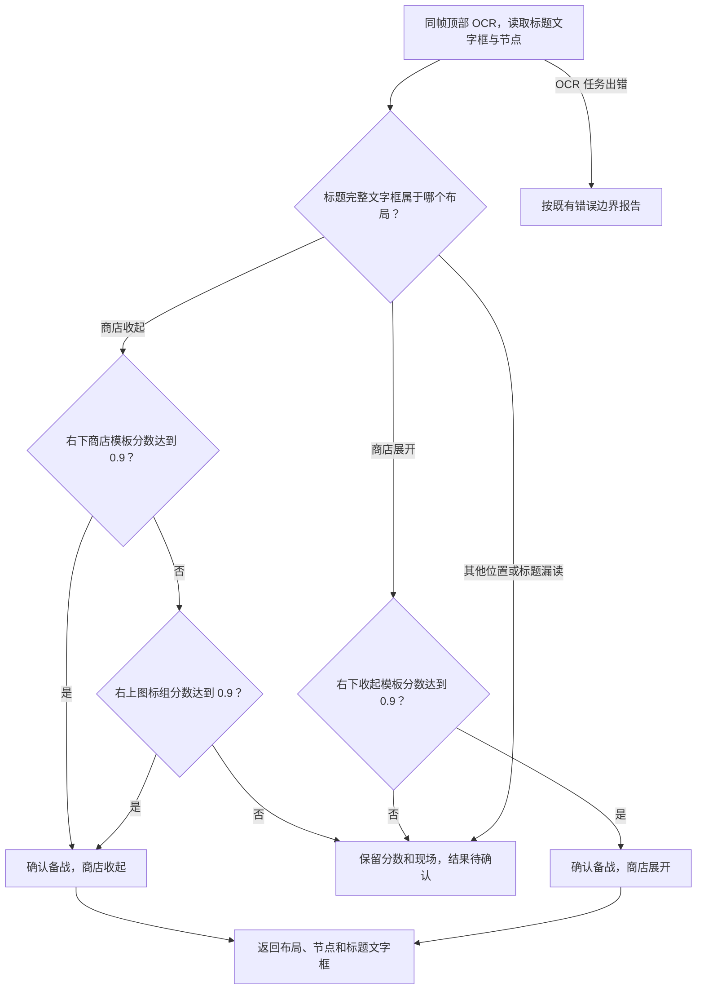
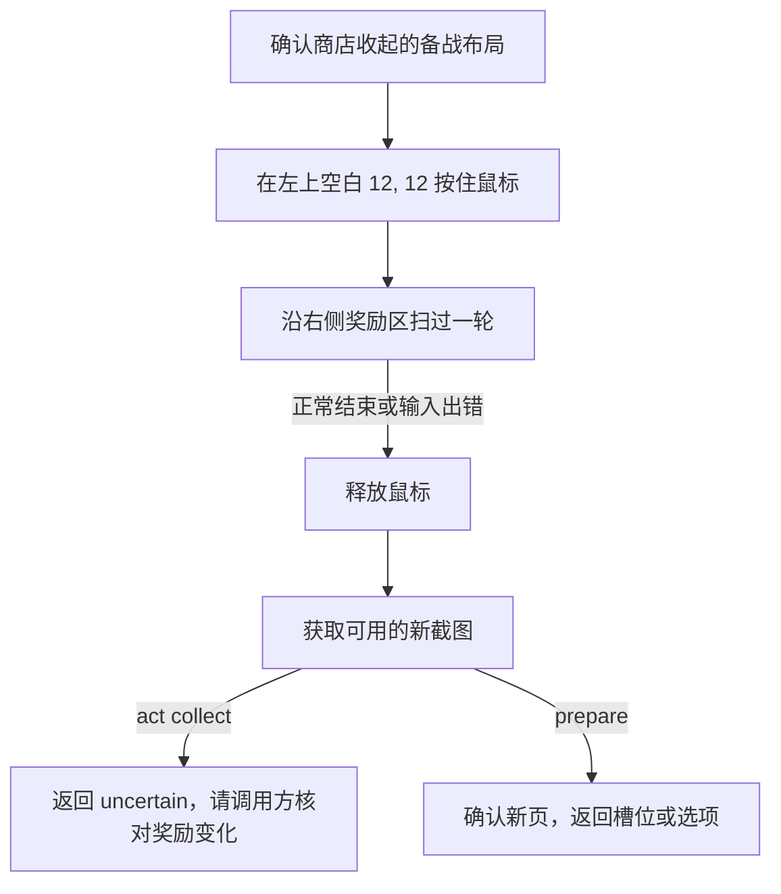
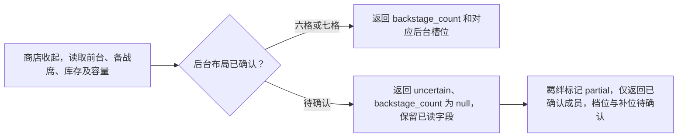
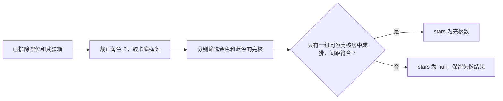
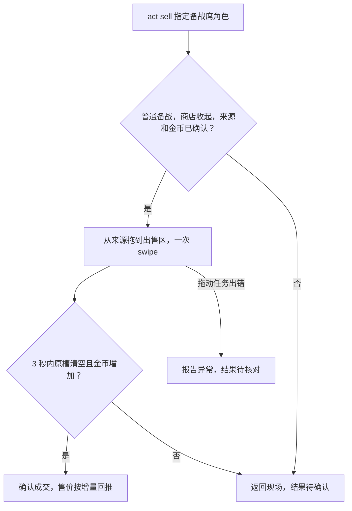
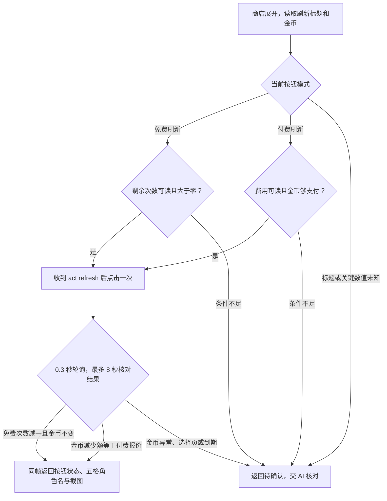

# 备战阶段

备战负责收奖励、整理局势、执行 AI 指定的运营动作，AI 决定后进入战斗。入场编排见[统一备战入口](prepare.md)，实现状态见文末。

## 执行顺序

奖励收集安排在本轮入口；选择完成或动作结束后从新画面继续，额外收集由明确指令触发。已处于选择页时从第 3 节继续。

## 1. 确认备战阶段

| 区域 | 坐标（x、y、宽、高） |
|---|---|
| 顶部 OCR | `(220, 20, 320, 115)` |
| 收起时的「备战阶段」和节点 | `(424, 28, 96, 32)`、`(425, 58, 90, 42)` |
| 展开时的「备战阶段」和节点 | `(235, 50, 110, 40)`、`(245, 88, 95, 42)` |
| 右下「商店」与右上图标组 | `(1520, 800, 220, 260)`、`(1540, 0, 380, 110)` |

槽位和奖励路径按 1920×1080、商店收起布局。标题须正好为去空白后的「备战阶段」。节点按 `数字-数字` 解析，位置、格式错误或漏读返回 `node: null`，已确认的备战仍可返回。示例为 `node: "3-4"`、`phase_box: [430, 33, 80, 24]`。

新帧重新读标题和节点，同帧结果供备战、出战和主角恢复复用。补给和主角入口也返回顶部节点。未识别场景时 `observe` 返回同帧和 `uncertain`，`act collect` 还返回可读分数。收起展开商店的等待规则见[统一备战入口](prepare.md#入场编排)。

## 2. 收取奖励

路径在 `x=1300～1616、y=148～460` 内有 18 个折返点。约 25 像素插值，共 120 个移动点，点间隔 40 ms。该调整针对漏领，效果待实机验证。

## 3. 领取后的选择和物品

出现选择框时返回标题、选项文字、可识别图标、选取数量与截图，并设 `needs_ai: true`。AI 指定选项后程序完成选择与确认，再读新画面。

容器、武装箱等物品作为当前局势的一部分交给 AI；打开、使用或选择由 AI 下指令，交互与完成特征按样例接入。

2026-11-15 录像确认「开启」简易武装箱占用备战席槽位，满席时仍可打开已有武装箱，四选一完成后容器消失。备战席容量按角色和容器共同计算，容器保留 `bench_N` 位置。简易箱和进阶箱的识别与操作见[武装箱](armament.md)。满席领奖与腾位后的恢复见[统一备战入口](prepare.md#备战席满与奖励暂存)。

## 4. 读取领取后的局势

| 内容 | 读取范围 | 来源 |
|---|---|---|
| 角色 | 前台 4 格、后台 6 或 7 格、备战席 9 格；名称、空位、星级、已上阵数量及上限 | 当前截图 |
| 经济 | 当前金币、购买经验显示的费用 | 当前截图 |
| 等级与经验 | 当前等级、已有经验、升级所需经验 | 当前截图 |
| 右侧装备库存 | 可见的装备或道具、名称或素材 ID、界面显示的数量 | 当前截图 |
| 羁绊推算 | 已知人数、当前档位、下一档及可补位角色 | 同帧阵容、已穿戴星徽与[羁绊规则表](traits.md#根据阵容推算) |
| 左侧羁绊（设计） | 完整可见的羁绊名称、人数、档位和高亮档，详见[备战羁绊识别](traits.md) | 当前截图 |
| 已穿戴装备 | 各卡片身上的已确认装备 | 穿戴和移动操作记录 |

同一帧读取并附该帧截图；已穿戴装备单独来自操作记录。

商店收起时，数值分别读取五个固定区域，坐标见 `tools/game/slots.py` 的 `NUMBERS`。金币和费用按整数、等级按 `Lv.数字`、经验和人数按 `数字/数字` 解析，去掉 OCR 空白字符。返回 `gold`、`level`、`experience: {current, required}`、`experience_cost` 和 `deployment: {current, limit}`。格式缺失的字段填 `null`，本次观察返回 `uncertain`，保留角色槽位及其他数值，界面仍为备战；OCR 任务错误单独报错。数值读取安排在页面确认后，每次观察执行一轮，模型随识别器复用。`prepare` 在收集后的最终帧读取，确认重试只判断页面。

生命值和经验费用是按钮与顶栏上的小字，改用放大两倍再识别：3-7 实机血量 `71` 直接认是空，放大后读对；等级 8、9 时按钮角落的费用 `4` 同样只在放大后读对。血量框保留到能包三位数，并从 OCR 文本中取数字（心形图标会被读成「.」）。

后台六格和七格分别使用 `back_1`～`back_6` 与 `back_1`～`back_7`。商店收起时比较两套坐标的后台卡槽上边框，按确认的布局读取空位、头像和已穿戴星徽。后台拖动在输入前独立确认布局，未确认时停止拖动。

每个已识别角色带 `positions`（`front`/`back`，来自 `data/characters.json`），库外图标不给定位。返回的 `front_capacity` 是前台格数（固定 4），与 `deployment.limit` 不同：上阵超过 4 人时第 5、6 人进 `back_1`、`back_2`，2-1 实机用 `move --to back_2` 把上阵数从 5/6 提到 6/6 验证。

商店展开时每格返回 `shop_prices`：卡底价格字号很小，裁出 `(center + 72, 288, 50, 36)` 放大两倍再 OCR 并取数字，1-6、2-1 实机 5 格全部读对（2、3、1、2、1）。空槽和装备卡的价格为 `null`，装备卡价格走 `shop_goods.price`。每格多一次放大 OCR（5 格），只在开店和商店展开的观察里执行。

节点进度 `plane`、`index`、`nodes`、`remaining` 由顶部节点号及示例路线长度得到。2026-11-28 用户提供的位面详情图和说明显示，位面 1 有 9 个节点，位面 2、3 各有 7 个节点；较早的 2-9 说明与这组画面不一致，适用条件待确认。未知位面返回 `nodes: null`。

`node_reference` 返回用户提供的示例路线，从当前节点列到该位面末尾；`possible_types` 是参考类型，不是对当前画面图标的识别结果。第一位面顺序为奖励、奖励、战斗、战斗、补给、战斗、遭遇、奖励或幕后茶歇、首领；第二、三位面为战斗、投资策略、补给、战斗、遭遇、奖励或幕后茶歇、首领。用户说明 2-6 奖励可能替换为幕后茶歇，第三位面与第二位面相同；1-8 的幕后茶歇见本次截图。实际页面和事件替换以当前画面为准，未知节点不推算类型。

例如 `2-6` 返回 `node_reference: {"source": "user_example", "nodes": [{"node": "2-6", "possible_types": ["奖励", "幕后茶歇"]}, {"node": "2-7", "possible_types": ["首领"]}]}`。节点号超出该位面示例时，`nodes`、`remaining` 和 `node_reference` 均为 `null`；节点号未识别或格式不符时，不返回进度字段。

后台布局待确认时，`slots` 省略整个后台区域。六格后台沿用各格模板，七格的 `back_4`～`back_7` 使用该布局的专用模板，两者空位阈值均为 0.9。七格左三格的空位样例仍待补，现阶段尝试识别头像，无法确认时返回 `unknown`。前台和备战席的空位阈值为 0.7。

前台沿用 `front_1`～`front_4`，备战席沿用 `bench_1`～`bench_9`。确认的空位为 `null`，头像待核对时返回 `{"unknown": true}` 及可用候选，同名角色按槽位分别返回。库存按 `bag_r行_c列` 编号，行从上往下、列从右往左，向左扩展时保留右列编号。领取、穿戴、使用或排序后重新观察格内物品。商店五格固定为 `shop_1`～`shop_5`，角色与名单外商品按[商店展开状态](buy.md#商店展开状态)读取。

### 角色星级

`observe` 和 `prepare` 在商店收起时，从同一张卡分别读取头像和 `stars`。星标使用卡片校正为 120×130 后的 `(18, 87, 102, 126)` 裁区（左、上、右、下），识别框映射到原截图。亮核筛选参考 [March7thAssistant 的卡片星级识别](https://github.com/moesnow/March7thAssistant/blob/6be8ddb54667041bc2c78d4987a7dcf71fcf14a4/tasks/weekly/currency_wars_ui.py#L990-L1025)。

金色和蓝色按颗数计，头像待确认时仍保留独立读到的星级。检测范围为 1～4 颗，已有截图覆盖 1～3 星，四星、拖动和遮挡待实机样例验证。

库存识别读取右侧两列，右列为 `c1`，左列为 `c2`。定位灰色、金色及实机样例中的蓝色特权装备和红色阿哈装备方框后去掉 2 像素边缘，与现有装备素材比较，返回 `inventory` 槽位表；每项包含素材 ID、路径、分数及截图中的 `box`。同一物品出现在多个格子时分别返回。最高分低于 0.8 或与次高分差小于 0.1 时，保留 `unknown` 与候选。未定位到方框时 `inventory` 为 `null`，表示库存待确认。顶部特殊道具独立识别，见[特殊道具](special-items.md)。空格样式与数量标记待样例确认。

## 5. 维护已穿戴装备

| 操作 | 记录更新 |
|---|---|
| 穿戴 | 确认装备到达指定卡片后，更新该卡片装备栏和来源库存 |
| 移动到空位 | 确认卡片到位后，装备记录随卡片转移 |
| 两张卡片交换 | 确认后两张卡片各携带原装备记录 |
| 游戏内手动穿戴 | 调用方告知结果后补记 |
| 首次接管已有局面 | 调用方补充已穿戴装备，建立初始记录 |

记录按当前槽位区分，同名角色分别维护，普通观察复用已确认记录。自动合成、出售、拆卸和替换时的归属变化随后续动作补齐。

## 6. AI 决策与动作结果

AI 决定购买对象、刷新、购买经验、出售、站位、装备分配、道具使用和出战时机；程序逐次执行明确指令并返回确认到的结果。

| 动作 | 确认内容与观察更新 |
|---|---|
| 打开商店 | 确认展开布局，读取五格角色、价格及商店状态 |
| 购买、刷新、出售 | 核对实际金币和相关商店、角色变化；购买流程见[购买角色](buy.md#单次购买流程) |
| [购买经验](experience.md) | 按指定经验量分次购买，逐次核对金币、经验和等级变化，更新上阵上限 |
| 移动、交换 | 核对来源与目标卡片；跨区域时更新上阵数量，装备记录随卡片更新 |
| 穿戴、使用物品 | 核对来源库存及目标变化；确认穿戴后更新装备记录 |
| 出战 | 确认进入战斗页面，结束本轮备战 |

观察按动作实际影响范围更新：购买可能触发自动合成，因此包含受影响的角色槽位。`success` 表示已确认达成目标，`failed` 表示前置条件不满足或确认未达成，`uncertain` 表示结果待核对；动作后的新选择通过 `needs_ai: true` 返回，等待 AI 期间服务空闲。

出战入口与监测见[战斗阶段](battle.md)。

### 售卖与商店开关

1-6 实机确认：MaaWin32 的 `touch_down`/`touch_move` 组合不触发游戏的角色拖拽，`post_swipe` 一次送进出售区可以成交。售价在拖动中显示，松开即消失，因此改为按金币增量回推并写入 `evidence.price`。连续卖出大丽花、灵砂、长夜月、托帕&账账时，金币 10 → 16，来源槽位逐格清空。

`--from` 可一次给出多个备战席槽位，按顺序逐个出售：每个目标在拖动前重新读帧，避免补领或自动合成改变槽位后拖错。全部成功时返回 `sold` 明细和 `gold_gained` 合计；中途失败立即停止，返回已完成的部分和剩余数量。三格批量实机 7.4 秒（约 2.5 秒/格）。

拖动时长由 900 毫秒降到 450 毫秒，1-6 与 2-1 实机各验证一次成交；再短需要更多实机样例。

`act shop-open`、`act shop-close` 按当前布局切换一次。已处于目标布局时直接返回。过场每 0.3 秒截图确认，最多 8 秒，遇到选择页时返回现场。

### 免费与付费刷新

观察字段为 `refresh_mode`、`refresh_cost`、`free_refreshes`、`gold`。免费模式费用为 0，付费模式免费次数为 0，漏读填 `null`，标题未知时模式为 `unknown`。

免费点击后若已显示付费按钮，按免费次数 0 核对。下一次付费刷新等待新指令。`evidence` 记录模式、费用及点击前数值。五格读取见[商店展开状态](buy.md#商店展开状态)，动画结束的独立标记待确认。

## 实现状态

| 能力 | 状态 |
|---|---|
| 备战确认（标题 OCR 与坐标 + 商店或图标组 0.9）、节点输出 | 已实现，验证见 `PROGRESS.md` |
| 角色名称与空位识别 | 已实现，19 格与 20 格保存帧通过 |
| 右侧奖励区 S 形收集 | 已实现，管理员服务实机领取过蓝色奖励球 |
| 指定槽位拖动 | 已实现，结果由调用方核对 |
| 备战席出售、商店开关与后台补领 | 已实现，保存帧回放及输入互斥测试通过，游戏内表现待验证 |
| 商店免费次数、刷新费用与单次刷新 | 已实现，免费 1 次与付费 2 金币截图读取通过，动作使用 Mock 验证 |
| 投资策略读取、单项刷新与选择衔接 | 已实现，录像帧回放通过 |
| 主角页读取、拖选、光环选择与返回备战 | 已实现，录像帧回放通过 |
| 出战及战斗确认 | 已实现，录像帧回放通过 |
| 统一备战入口 | `prepare` 已实现确认重试、收起商店、收集与角色、数值观察 |
| 奖励后的选择分流 | 投资策略与主角已接入，其他选择待样例 |
| 金币、等级、经验、购买经验费用、上阵数量读取 | 已接入，三张保存帧经正常入口回放通过，游戏内表现待验证 |
| 角色星级读取 | 已接入前台、后台和备战席，1～3 星保存帧通过 |
| 右侧装备库存识别 | 已接入右侧两列，普通备战及武装箱到账保存帧通过，空格和数量待样例 |
| 装备记录与穿戴动作 | 未接入 |
| 商店五格识别及购买结果验证 | 已接入，购买前后帧回放通过；封装命令待实机验证 |

接入顺序：补第 4 节观察与其他选择分流 → 跑通商店购买闭环 → 补移动验证与装备记录。

`observe` 保持只读，`act collect` 和 `act move` 保持单动作调用；统一入口负责编排，游戏输入串行，识别复用只读上下文与 16 个工作线程。

游戏内输入与各动作的实机表现以 `PROGRESS.md` 的记录为准。
