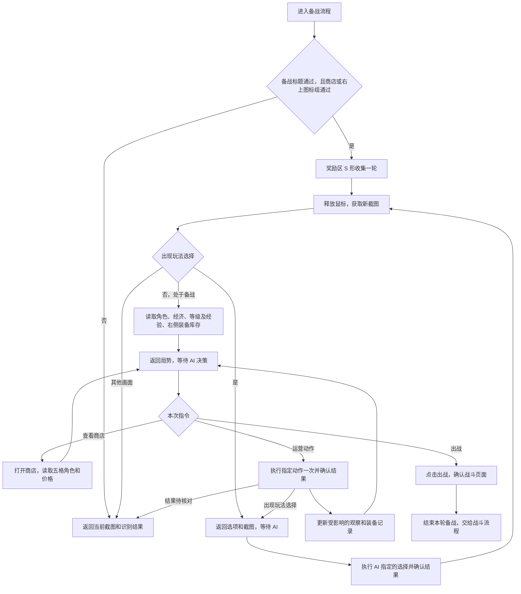

# 备战阶段

备战负责收奖励、整理局势、执行 AI 指定的运营动作，AI 决定后进入战斗。入场编排见[统一备战入口](prepare.md)，实现状态见文末。

## 执行顺序

奖励收集安排在本轮入口；选择完成或动作结束后从新画面继续，额外收集由明确指令触发。已处于选择页时从第 3 节继续。

## 1. 确认备战阶段

同一张截图，坐标依次为 `x、y、宽、高`：

- 对顶部局部区域 `(220, 20, 320, 115)` 做一次 OCR，去除空白后文字必须是「备战阶段」，完整文字框须包含在商店收起标题区域 `(424, 28, 96, 32)` 内。中央过场的同名横条和其他坐标处的文字不作为确认依据，不再加载标题图片模板。
- 以下至少一项达到 **0.9**：右下「商店」`(1520, 800, 220, 260)`；右上四个图标组 `(1540, 0, 380, 110)`。

标题文字和坐标通过后先匹配商店，未通过再匹配图标组；只有标题或只有辅助标志都不确认备战。

`preparation` 在本条件未通过时用同帧识别投资策略，8 秒内继续识别备战或投资策略，超时返回最后一帧与 `uncertain`，详见[投资策略](strategy.md)。`act collect` 未通过时返回 `uncertain`、分数与截图。

阶段和布局分开维护，槽位及奖励路径按 **1920×1080、商店收起**。展开商店时，OCR「备战阶段」的完整文字框须包含在 `(235, 50, 110, 40)` 内，并且右下「收起」匹配达到 0.9；`prepare` 点击收起后等待 2 秒，最多确认 3 次，间隔 2 秒。

同次顶部 OCR 读取节点，商店收起时完整文字框须位于 `(425, 58, 90, 42)`，展开时位于 `(245, 88, 95, 42)`，文字按 `数字-数字` 解析。CLI 返回 `node: "3-4"` 以及实际标题文字框 `phase_box: [430, 33, 80, 24]`；节点缺失或格式、位置不符时 `node: null`，不把上一帧节点带入，也不单独阻止已经确认的备战。补给观察和主角入口也返回可读到的顶部节点。

标题、坐标、节点由同一张截图的一次局部 OCR 得到，同帧在备战分流、战斗入场、主角恢复和局势读取间复用，新截图重新读取。OCR 任务出错按既有错误边界报告，与标题或节点未找到区分。

## 2. 收取奖励

- 从左上空白 `(12, 12)` 按下鼠标左键。
- 沿右侧奖励区 18 个折返点移动，覆盖 `x=1300～1616、y=148～460`。
- 折线按约 50 像素步距插值，共 63 个移动点，相邻间隔 20 ms。
- 一轮结束或任务出错时释放鼠标并截图。

`act collect` 返回截图及 `uncertain`，奖励变化由调用方按返回画面核对。`prepare` 用收集后的新截图确认备战或投资策略，再返回槽位或选项。

## 3. 领取后的选择和物品

出现选择框时返回标题、选项文字、可识别图标、选取数量与截图，并设 `needs_ai: true`。AI 指定选项后程序完成选择与确认，再读新画面。

容器、武装箱等物品作为当前局势的一部分交给 AI；打开、使用或选择由 AI 下指令，交互与完成特征按样例接入。

2026-11-15 录像确认「开启」简易武装箱占用备战席槽位，满席时仍可打开已有武装箱，四选一完成后容器消失。备战席容量按角色和容器共同计算，容器保留 `bench_N` 位置，识别分流待接入。满席领奖与腾位后的恢复见[统一备战入口](prepare.md#备战席满与奖励暂存)。

## 4. 读取领取后的局势

| 内容 | 读取范围 | 来源 |
|---|---|---|
| 角色 | 前台 4 格、后台 6 格、备战席 9 格；名称、空位、星级、已上阵数量及上限 | 当前截图 |
| 经济 | 当前金币、购买经验显示的费用 | 当前截图 |
| 等级与经验 | 当前等级、已有经验、升级所需经验 | 当前截图 |
| 右侧装备库存 | 可见的装备或道具、名称或素材 ID、界面显示的数量 | 当前截图 |
| 已穿戴装备 | 各卡片身上的已确认装备 | 穿戴和移动操作记录 |

同一帧读取并附该帧截图；已穿戴装备单独来自操作记录。

商店收起时，数值分别读取五个固定区域，坐标见 `tools/game/slots.py` 的 `NUMBERS`。金币和费用按整数、等级按 `Lv.数字`、经验和人数按 `数字/数字` 解析，去掉 OCR 空白字符。返回 `gold`、`level`、`experience: {current, required}`、`experience_cost` 和 `deployment: {current, limit}`。格式缺失的字段填 `null`，本次观察返回 `uncertain`，保留角色槽位及其他数值，界面仍为备战；OCR 任务错误单独报错。数值读取安排在页面确认后，每次观察执行一轮，模型随识别器复用。`prepare` 在收集后的最终帧读取，确认重试只判断页面。

槽位沿用 `front_1`～`front_4`、`back_1`～`back_6`、`bench_1`～`bench_9`；确认的空位为 `null`，待核对为 `{"unknown": true}` 及可用候选，同名角色按槽位分别返回。库存按 `bag_r行_c列` 编号，行从上往下、列从右往左，向左扩展时保留右列编号。领取、穿戴、使用或排序后重新观察格内物品。商店五格固定为 `shop_1`～`shop_5`，含角色名称与实际价格，展开布局见[购买角色](buy.md#商店展开状态)。

库存识别第一版读取最右列。定位灰色方框后去掉 2 像素边缘，与现有装备素材比较，返回 `inventory` 槽位表；每项包含素材 ID、路径、分数及截图中的 `box`。同一物品出现在多个格子时分别返回。最高分低于 0.8 或与次高分差小于 0.1 时，保留 `unknown` 与候选。未定位到方框时 `inventory` 为 `null`，表示库存待确认。顶部两个计数图标独立于本次网格范围。空格样式、数量标记与多列列距待样例确认。

## 5. 维护已穿戴装备

| 操作 | 记录更新 |
|---|---|
| 穿戴 | 确认装备到达指定卡片后，更新该卡片装备栏和来源库存 |
| 移动到空位 | 确认卡片到位后，装备记录随卡片转移 |
| 两张卡片交换 | 确认后两张卡片各携带原装备记录 |
| 游戏内手动穿戴 | 调用方告知结果后补记 |
| 首次接管已有局面 | 调用方补充已穿戴装备，建立初始记录 |

记录按当前槽位区分，同名角色分别维护，普通观察复用已确认记录。自动合成、出售、拆卸和替换时的归属变化随后续动作补齐。

## 6. AI 决策与动作结果

AI 决定购买对象、刷新、购买经验、出售、站位、装备分配、道具使用和出战时机；程序逐次执行明确指令并返回确认到的结果。

| 动作 | 确认内容与观察更新 |
|---|---|
| 打开商店 | 确认展开布局，读取五格角色、价格及商店状态 |
| 购买、刷新、出售 | 核对实际金币和相关商店、角色变化；购买流程见[购买角色](buy.md#单次购买流程) |
| 购买经验 | 核对金币、经验和等级变化，更新上阵上限 |
| 移动、交换 | 核对来源与目标卡片；跨区域时更新上阵数量，装备记录随卡片更新 |
| 穿戴、使用物品 | 核对来源库存及目标变化；确认穿戴后更新装备记录 |
| 出战 | 确认进入战斗页面，结束本轮备战 |

观察按动作实际影响范围更新：购买可能触发自动合成，因此包含受影响的角色槽位。`success` 表示已确认达成目标，`failed` 表示前置条件不满足或确认未达成，`uncertain` 表示结果待核对；动作后的新选择通过 `needs_ai: true` 返回，等待 AI 期间服务空闲。

出战入口与监测见[战斗阶段](battle.md)。

### 售卖与商店开关

`act sell --from bench_8` 首版支持商店收起时的备战席角色。确认来源角色和金币后，按住角色移到空白处，读取左侧出售面板的标题和售价；售价确认后移到右侧出售区释放。面板或售价待确认时拖回来源并释放，返回现场。输入任务出错时释放鼠标并报告异常。成交以来源格清空且金币增加额等于实际售价确认，最多等 3 秒；输入各发送一次。录像 6.1～7.1 秒显示右侧出售区及 4 金币售价，成交后金币 76→80。

`act shop-open`、`act shop-close` 按当前布局执行一次切换，已在目标布局时直接返回。每 0.3 秒截图确认，最多等 8 秒；过场继续观察，遇到选择页返回现场。出售和领取只在商店收起的普通备战页执行；投资策略、主角选择及简易武装箱选择单独分流。

### 免费与付费刷新

展开商店后，`shop` 只读当前刷新状态，`act shop-open` 同时返回刷新信息。先识别按钮标题，再读取对应数字：`免费刷新` 下方是剩余次数，当前费用为 0；`刷新` 下方是金币费用，当前免费次数为 0。返回 `refresh_mode`、`refresh_cost`、`free_refreshes` 和 `gold`；漏读填 `null`，标题未知时模式为 `unknown`。商店收起时先返回布局，展开由 AI 指定。

`act refresh` 按当前按钮执行一次。免费模式确认次数大于 0，付费模式确认金币足够；次数、价格或金币漏读时交回 AI。免费刷新以次数减少 1 且金币不变确认；下一帧若已显示付费按钮，按免费次数 0 核对。付费刷新以金币减少额等于点击前费用确认。每 0.3 秒观察，最多等 8 秒，金币异常变化或进入选择页时返回 `uncertain`。返回新帧的按钮状态与截图，`evidence` 记录本次使用的模式、费用及点击前数值。一次命令发送一次点击，免费耗尽后的付费刷新由下一条指令决定。商店五格文字与刷新动画完成特征待接入。

## 实现状态

| 能力 | 状态 |
|---|---|
| 备战确认（标题 OCR 与坐标 + 商店或图标组 0.9）、节点输出 | 已实现，验证见 `PROGRESS.md` |
| 19 个槽位的角色名称与空位识别 | 已实现，四名角色样例通过 |
| 右侧奖励区 S 形收集 | 已实现，管理员服务实机领取过蓝色奖励球 |
| 指定槽位拖动 | 已实现，结果由调用方核对 |
| 备战席出售、商店开关与后台补领 | 已实现，保存帧回放及输入互斥测试通过，游戏内表现待验证 |
| 商店免费次数、刷新费用与单次刷新 | 已实现，免费 1 次与付费 2 金币截图读取通过，动作使用 Mock 验证 |
| 投资策略读取、单项刷新与选择衔接 | 已实现，录像帧回放通过 |
| 主角页读取、拖选、光环选择与返回备战 | 已实现，录像帧回放通过 |
| 出战及战斗确认 | 已实现，录像帧回放通过 |
| 统一备战入口 | `prepare` 已实现确认重试、收起商店、收集与角色、数值观察 |
| 奖励后的选择分流 | 投资策略与主角已接入，其他选择待样例 |
| 金币、等级、经验、购买经验费用、上阵数量读取 | 已接入，三张保存帧经正常入口回放通过，游戏内表现待验证 |
| 角色星级读取 | 未接入 |
| 右侧装备库存识别 | 已接入最右列，六格与两格保存帧通过；空格、数量和多列待样例 |
| 装备记录与穿戴动作 | 未接入 |
| 商店五格识别及购买结果验证 | 未接入，商店名称 OCR 已有离线试验 |

接入顺序：补第 4 节观察与其他选择分流 → 跑通商店购买闭环 → 补移动验证与装备记录。

`preparation` 保持只读，`act collect` 和 `act move` 保持单动作调用；统一入口负责编排，游戏输入串行，识别复用只读上下文与 16 个工作线程。

游戏内输入与各动作的实机表现以 `PROGRESS.md` 的记录为准。
