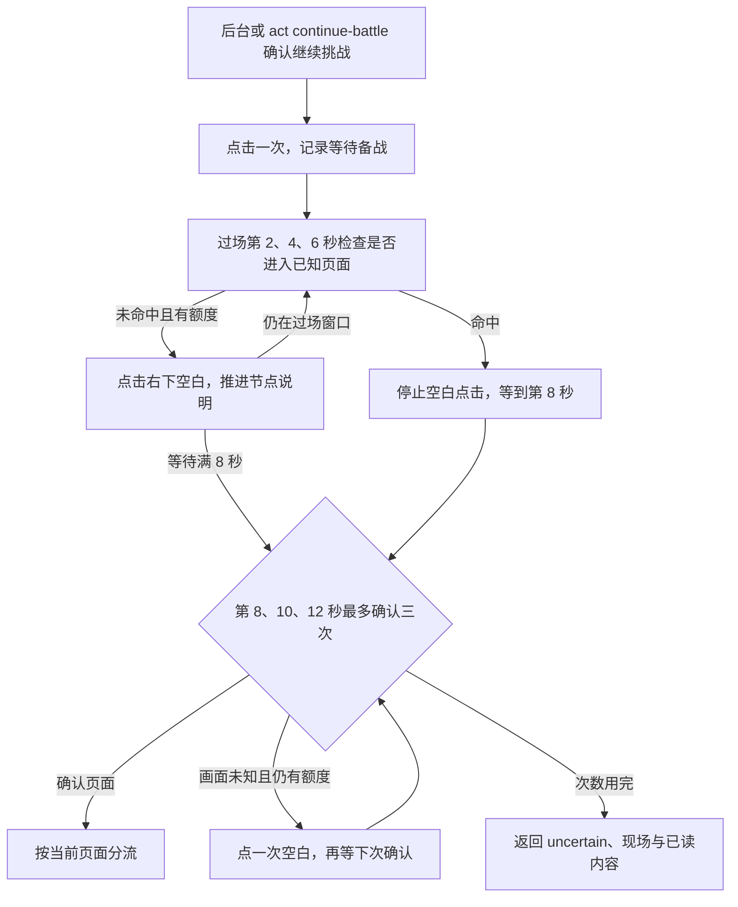
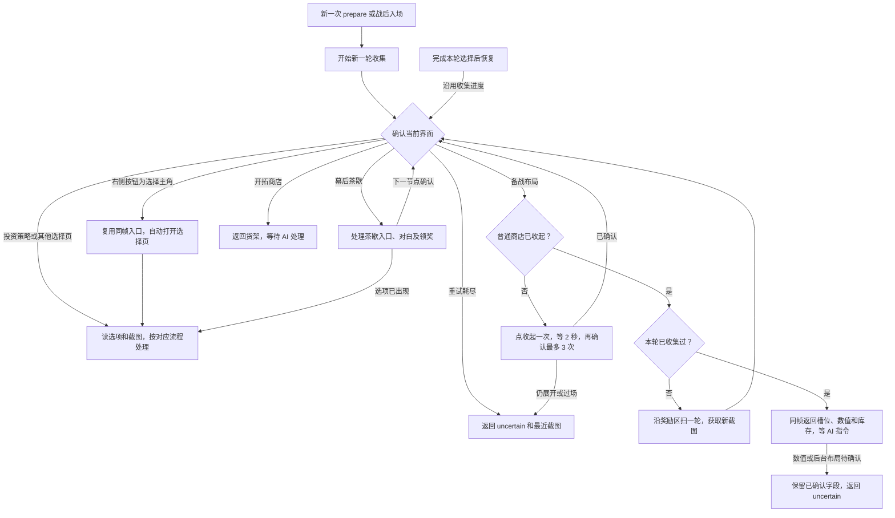
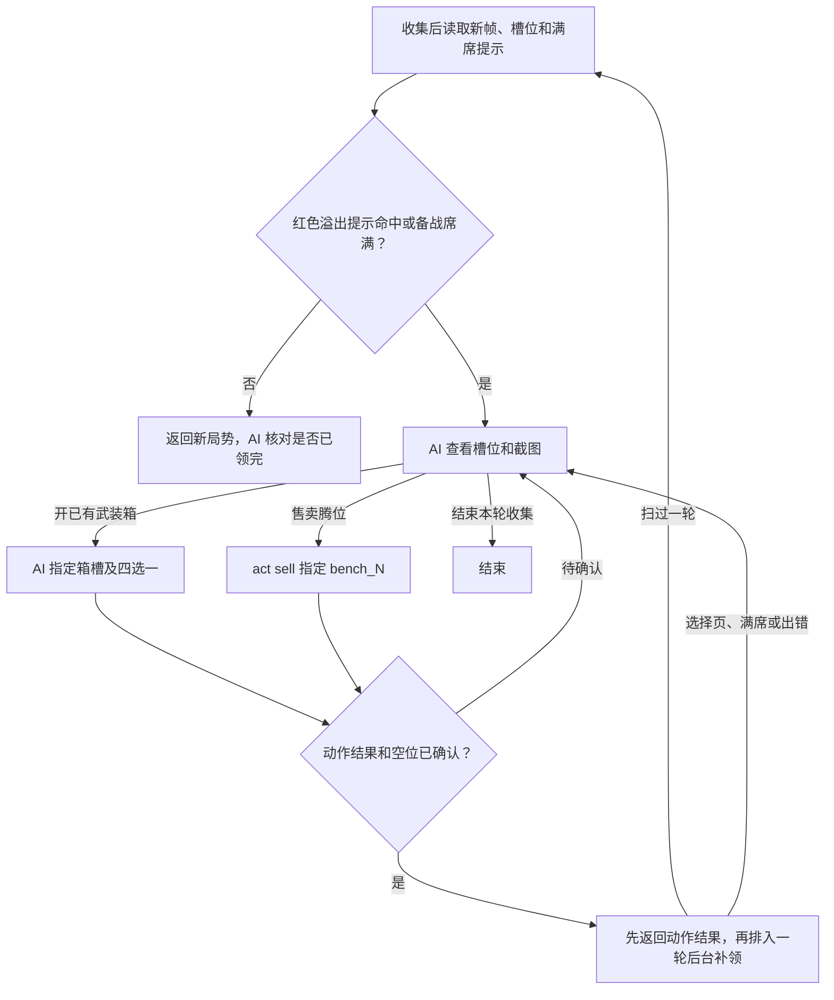
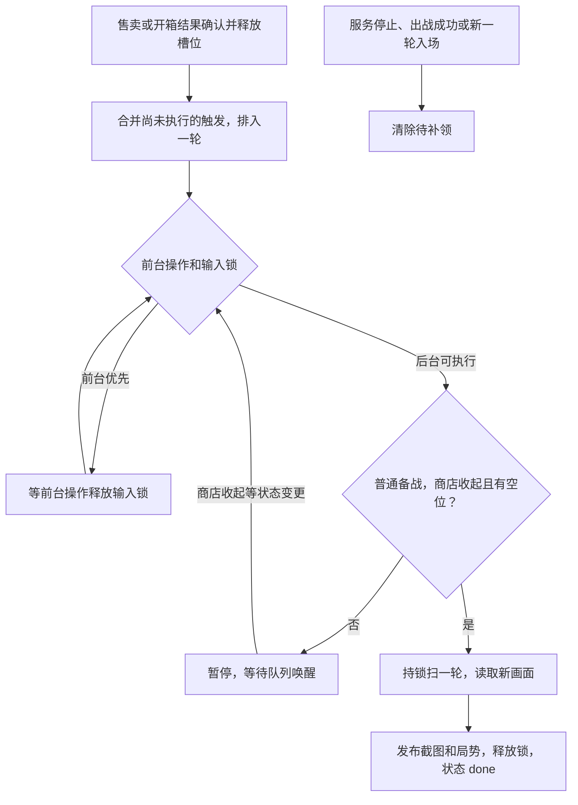

# 统一备战入口

`prepare` 执行备战入场编排，实现在 `tools/flow/prepare.py`。`observe` 读取当前帧，由 `tools/flow/observe.py` 按界面返回识别结果。

备战入场、过场等待、只读观察及服务动作共用同一套页面判定。先识别武装箱、开拓商店、主角选择页、补给、遭遇、投资策略及幕后茶歇，再判断普通备战布局。普通商店收起后，`prepare` 和 `observe` 区分茶歇和主角入口。动作侧仍可从同帧取得普通备战和行动按钮状态。

## 战斗收尾

空白点为 `(1910, 1070)`，每次入场或选择恢复合计最多 3 次。确认阶段也等待选项文字、商店收起等实际结果。输入或识别任务出错时返回异常上下文和最近截图。

## 入场编排

右侧[按钮映射](actions.md)和最终观察复用同帧 OCR。「出战」标记可执行动作，其他 buff 名称保留原文。收起商店和继续挑战各点击一次，收集按本轮进度执行。

| 分支 | 专用流程 |
|---|---|
| 选择主角 | [主角与光环](protagonist.md)，1-9、2-9 的入口及选择页优先于普通备战 |
| 投资策略、补给、遭遇、武装箱 | [投资策略](strategy.md)、[补给](supply.md)、[遭遇](encounter.md)、[武装箱](armament.md) |
| 开拓商店 | [开拓商店](trail-shop.md)，关店前暂停普通备战及后台补领 |
| 幕后茶歇 | [幕后茶歇](tea-break.md)，返回分支和委托，核对结算后进入下一节点 |
| 羁绊选择（设计） | [梦境交织](dreamweave.md)确认双选后核对同行金标，[双龙吟](double-dragons.md)等待 AI 指定一项，核对加入提示和金标 |

后台收尾持有操作锁，`status` 显示 busy 和等待备战，`observe` 读取当前画面。停止服务时等待当前步骤结束。

## 备战席满与奖励暂存

同帧红色提示「备战席已满，请出售角色或提升等级」模板匹配达到 0.9 时，按约定判定「角色卡溢出」，独立于槽位识别结果。返回 `reason: "character_overflow"`、`needs_ai: true`、`required_action: "sell"`，要求 AI 指定售卖角色；额外小卡不参与识别，前后台 `unknown` 保留为识别信息。提示未命中且常规备战席 9 格均非空时返回 `bench_full`。后台补领在商店收起后先检查提示，命中即暂停；未命中再检查实际空位，售卖后按同一条件恢复补领。

`2026-11-15 13-49-12.mp4` 中，备战席同时容纳角色和「开启」武装箱。约 2 秒领取晶矿时出现「备战席已满，需要售卖备战区角色才可开启晶矿」，掉落继续留在右侧。约 6～8 秒售出第八格角色，金币 76→80，空出一格；约 10～12 秒领取奖励又新增角色，备战席恢复满格。约 13～19 秒在满席状态打开已有的简易武装箱，返回四选一，选择后武装箱消失，释放格子。约 30～40 秒继续领取并处理第二个武装箱，最后清空奖励区。主角入口与这些待处理奖励同时存在。

据此补充后续实现：

备战席容量包含角色与容器，容器用 `bench_N` 指定。扫过一轮记录手势完成，奖励是否领完由 AI 观察。

`PreparationFlow.collected` 表示入场时已扫过一轮，`Collector` 分别维护待补领任务、执行状态和最近一次结果。售卖腾位、后台补领和上述红色满席提示已接入，容器类型与内容选择待接入。录像提供的是领奖和容器样例，满席购买触发自动升星仍沿购买设计验证。

## 后台补领与 AI 决策

领取开始后，前台请求等待本轮释放鼠标和操作锁。下一条动作以当前截图重新核对目标、金币和条件。

后台补领、独立售卖与商店开关已实现。保存帧经正常 Session 入口回放通过：出售售价 4、金币 76→80，后台返回 19 个槽位并读到新增角色「刃」，同时到来的开店请求等待补领结束，开店和收起均确认成功。输入使用 Mock，游戏内表现待验证。

售卖确认或[武装箱](armament.md)装备到账后排入补领。服务停止、出战成功或进入新一轮备战时清除待领取。`status` 返回补领状态摘要，`rewards` 读取最近一次完整补领结果。领取期间到来的前台请求等待本轮释放操作锁，其他前台并发请求仍沿用 `busy`。后台结果保留当前截图和识别数据，`done` 表示这一轮补领任务完成。

## 依据

时机来自 `2026-11-14 11-14-29.mp4`：约 2.7 秒点击，约 9 秒商店展开。2026-11-14 实机从 1-8 结算继续后出现「强敌来袭／点击空白处继续」，原流程约 13.8 秒内三次确认仍返回未知，据此增加右下空白点击，具体效果记录见 `PROGRESS.md`。
