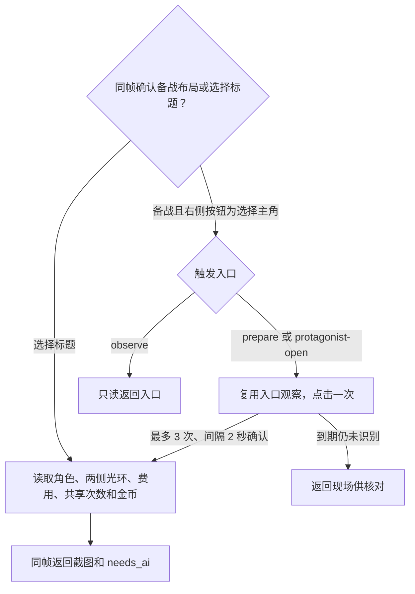
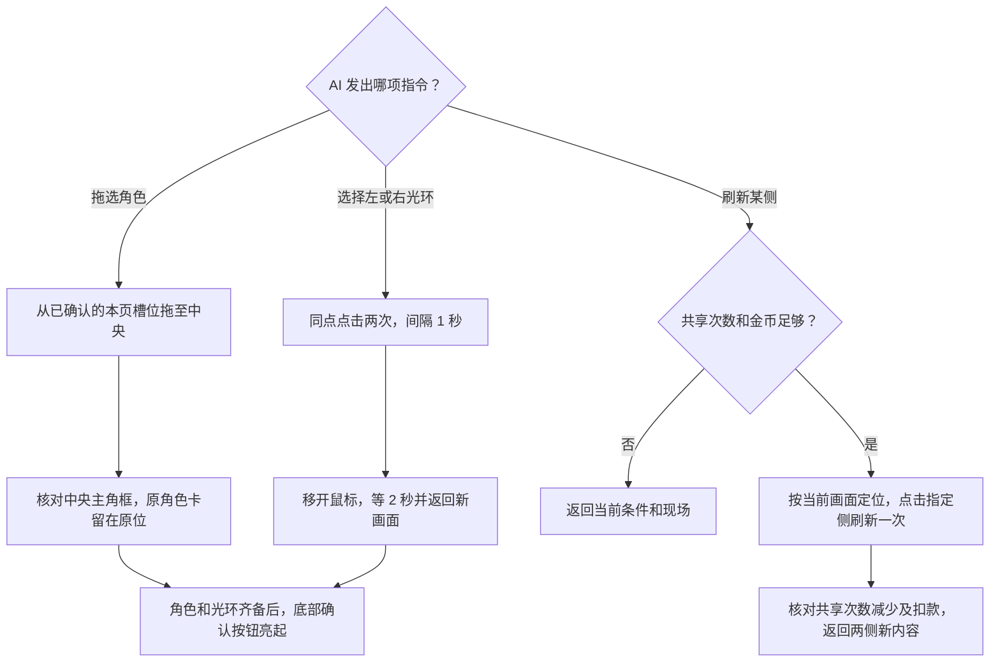
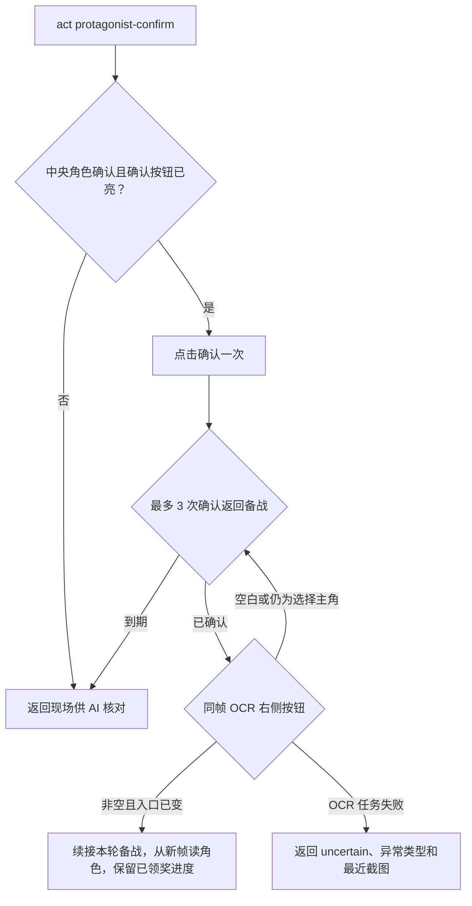

# 选择主角

1-9、2-9 备战有此流程，实现在 `tools/screens/protagonist.py`。布局与坐标来自 `2026-11-14 12-08-58.mp4` 的 1-9 画面（1920×1080）。

## 命令

```powershell
.\.venv\Scripts\python.exe tools/cw.py observe
.\.venv\Scripts\python.exe tools/cw.py act protagonist-open
.\.venv\Scripts\python.exe tools/cw.py act protagonist-character --slot front_1
.\.venv\Scripts\python.exe tools/cw.py act protagonist-aura --option 1
.\.venv\Scripts\python.exe tools/cw.py act protagonist-refresh --option 2
.\.venv\Scripts\python.exe tools/cw.py act protagonist-confirm
```

`observe` 只读观察；`option` 从左到右为 1、2；角色使用本页的 `front_1`～`front_4`、`back_1`～`back_6`。各动作独立返回现场，由 AI 决定下一步，刷新只在明确指令下执行。

## 分流



以「选择一个角色获得主角光环」识别选择页。备战入口使用[右侧按钮文字](actions.md)。节点编号用于报告进度。该分流优先于普通备战，识别后停止空白点击。

## 角色与光环



角色选择页坐标随本模块维护，录像在 12.3～12.9 秒显示拖选动作。两侧光环观察返回名称、标签、可见效果、敌人难度变化与刷新费用。选中边框用于画面展示，程序通过确认按钮亮起和页面状态核对。只选角色时游戏提示「尚未选择主角光环」。悬停会放大卡片。

录像中每次刷新花 1 金币。右侧刷新后共享次数 6→5，金币 46→45。左侧刷新后次数 5→4，金币 45→44。

## 确认与恢复



等待次数包含按钮文字确认，备战确认前不读取按钮。按钮名称会随 buff 改变，复用[右侧行动按钮](actions.md)的文字区域和模型。角色与空位复用已有头像库、候选阈值和工作线程。新判据待实机验证。

拖选、刷新和确认各执行一次，光环按两次点击执行。空位或角色待确认时返回对应槽位，刷新次数为零或金币不足时返回 `failed`。输入前的任务错误直接报告，输入后返回 `uncertain`、异常类型和最近截图。

## 录像样例

- 约 7 秒：角色与光环均未选，左「疾行派对客」、右「意志传承」，共享刷新 6 次。
- 约 13 秒：云璃已放入中央，光环未选。
- 约 17 秒：右侧光环出现选中边框，未刷新。
- 约 21 秒：右侧刷新为「连携追击」，剩 5 次、金币 45。
- 约 25 秒：左侧刷新为「双数成阵」，剩 4 次、金币 44，确认按钮亮起。
- 约 39 秒：返回 1-9 备战，右侧出现「出战」。

保存帧经 Session 入口回放覆盖读取、自动打开、拖选、单侧刷新、光环两次点击与最终确认，输入使用 Mock；随后恢复普通备战、收集一轮并返回 19 个槽位。记录见 `tools/.runtime/protagonist-video/session-replay.json`。
