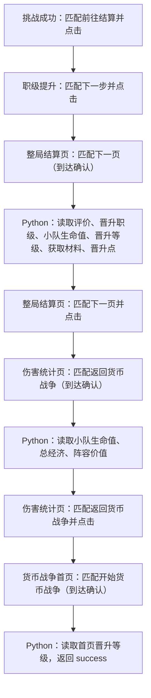

# 整局结算

实现在 `tools/flow/settlement.py`，用 1920×1080 画面。最后一关胜利后依次经过挑战成功、职级提升、整局结算与伤害统计四页，最后回到货币战争首页。四页的位置和按钮都固定，点击与到达判定交给三段短 Pipeline，Python 只负责调用、读取数据和判定结果。

## 三段 Pipeline

分三段而不是一段，是因为结算数据分布在三个页面上：一段 Pipeline 会把中间页直接点过去，之后再也读不到。每段以「下一页面的按钮已出现」作为到达条件，Python 在同一帧读取本页数据后再启动下一段。

## 节点与坐标

| 段 | 节点 | 模板（区域） | 点击 | 完成后进入 |
|---|---|---|---|---|
| 整局结算 | `Challenge` | `settlement_continue.png`（`700, 850, 520, 145`） | `(960, 895)` | `Promotion` |
| 整局结算 | `Promotion` | `settlement_next.png`（同上） | `(960, 951)` | `Summary` |
| 整局结算 | `Summary` | `settlement_page.png`（同上） | 不点击 | 到达确认，结束本段 |
| 伤害统计 | `Summary` | `settlement_page.png`（同上） | `(960, 899)` | `Damage` |
| 伤害统计 | `Damage` | `settlement_return.png`（同上） | 不点击 | 到达确认，结束本段 |
| 首页 | `Damage` | `settlement_return.png`（同上） | `(960, 899)` | `Home` |
| 首页 | `Home` | `settlement_home.png`（`1380, 900, 480, 120`） | 不点击 | 到达确认，结束本段 |

四页按钮都在同一横条内，所以共用一段识别区域；「下一步」比其余三个低约 56 像素，点击坐标单独给出。模板取按钮文字区（`asset/settlement/`），阈值 0.85；带动作的节点设 `post_delay` 800 毫秒与 `timeout` 8000 毫秒，到达确认节点同样带 8000 毫秒上限。实机换页会先经过没有按钮的过场，Pipeline 在这段时间内继续重试识别，因此不需要额外等待逻辑。

文字模板比整块按钮区分度高：整块按钮模板在「下一页」与「下一步」之间达到 0.888，太贴近阈值；只取文字区后两者降到 0.776 与 0.777，其余组合不超过 0.522。

## 数据读取

Pipeline 结束于到达确认节点，此时画面就是该页，Python 立刻读本页文字：

| 页面 | 读取 |
|---|---|
| 整局结算 | 评价（`SSS`）、晋升职级、小队生命值、晋升等级、获取材料、晋升点 |
| 伤害统计 | 小队生命值、总经济、阵容价值 |
| 首页 | 首页晋升等级 |

数字取区域内第一段连续数字，`晋升等级54`、`获取材料100`、`100小队生命值` 三种排布都能解析；缺项返回 `null`，不填默认值。

## 失败与衔接

- Pipeline 在点击前就停住，说明当前画面不是结算页：返回 `failed`，不发送输入。
- 点击后 8 秒内没有出现下一页面的按钮：返回 `uncertain`，带上各节点的完成情况，不重发点击。
- 点击后截图或读取失败：返回 `uncertain` 并保留最近画面，异常类型与上下文写进 `message`。
- 最后一关没有「继续挑战」，后台战斗监测仍报告战斗阶段，由 AI 观察后执行 `act settle`；成功后把「货币战争首页」写回战斗模块的阶段，后台监测随即退出战斗分支。
- 挑战失败页的顺序未取得样例；`navigation.current_screen` 已能识别「挑战失败」，该分支待实测补充。

## 验证依据

2026-11-22 3-7 最后一关实机：挑战成功 →（960, 895）→ 职级提升「财富造物主3」（960, 951）→ SSS 结算（960, 899）→ 伤害统计（960, 899）→ 首页。五帧保存在 `test/fixtures/settlement/`，模板与识别区域逐项离线核对；读出「SSS」「财富造物主3」「晋升等级54」「获取材料100」「晋升点2700」「100小队生命值」「319总经济」「79阵容价值」与首页「54」。

四条用例经 Session 入口用真实 Pipeline 与保存帧回放：完整四页点击与数据读取、无结算按钮时不点击、点击后 8 秒未到下一页返回 `uncertain`、点击后截图失败保留现场。游戏内输入为本次手动点击确认，`act settle` 封装本身待实机复跑。
