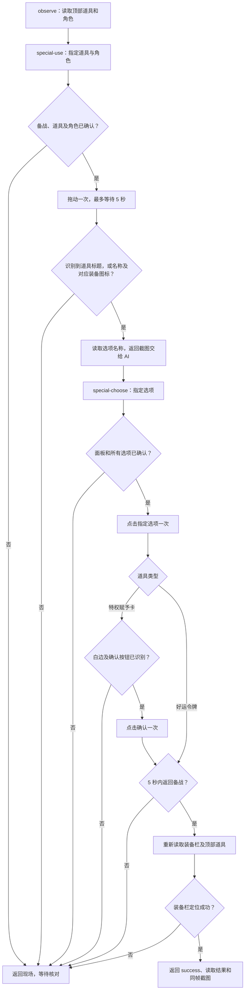

# 特殊道具

备战商店收起时，右上道具区识别「特权赋予卡」和「好运令牌」，返回 `special_items` 中的类型与图标坐标。两种图标分别以实机截图为模板，图标可能随道具数量左右移动。数量及其他道具暂不读取。

`act special-use --item privilege|luck --target back_2` 指定道具与角色。程序确认备战布局、道具位置和目标角色后拖动一次，最多等 5 秒；识别到对应标题或任一装备名就返回选择面板。按名称确认时，需同时匹配该选项的装备图标：实机备战页的「前台区」也会落入好运令牌选项文字区域。选项名称未读全时返回 `uncertain` 和截图。标题漏识时，本次使用的道具类型提供读取选项的上下文。后台六格和七格使用各自坐标。

`observe` 可读取标题命中的特殊道具面板；本次使用后标题漏识时，也可根据选项名称识别。`act special-choose --option 1` 按从左到右编号选择，必须先读全当前选项。特权赋予卡选中后确认白边，再点击「确认选择」；好运令牌直接点击选项。两者都等待最多 5 秒返回备战，重新读取装备栏及顶部特殊道具，返回同帧截图。未确认结果时停止，不重复发送输入。返回备战并读到装备栏不等同于核实选中装备已到账。

目前依据实机样例适配特权赋予卡两项和好运令牌四项布局，其他选项数量与布局待样例确认。保存帧已回放这两条路径；新增的封装动作尚待实机验证。OCR 原样返回名称，可能包含误识。
