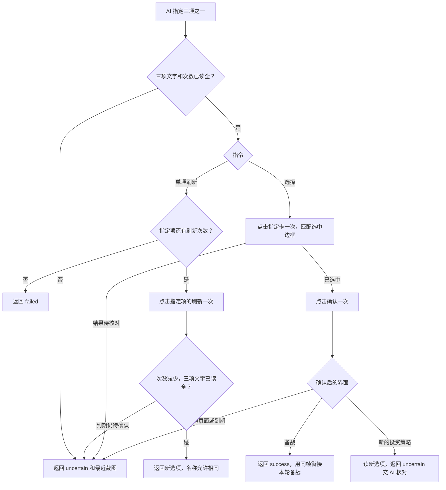

# 投资策略

依据 `2026-11-14 09-37-25.mp4` 约 49～67 秒的选择页及 2026-11-28 银色卡片实机帧，当前适配 1920×1080 的金色、虹彩和银色选中边框。节点编号只用于描述进度，进入本流程以页面标题为准；其他品质的卡片另行适配。

## 命令

```powershell
.\.venv\Scripts\python.exe tools/cw.py observe
.\.venv\Scripts\python.exe tools/cw.py act strategy-refresh --option 1
.\.venv\Scripts\python.exe tools/cw.py act strategy --option 3
```

编号从左到右为 1～3。`observe` 在当前帧识别本页，命中后返回选项；识别不全时返回待确认。

## 读取

先匹配「请选择投资策略」标题，再读三项名称、描述、各自剩余刷新次数和当前选中项，附同帧截图与 `needs_ai: true`。标题、选中边框、商店展开的两处标志都用 0.9 阈值。名称、描述或次数未读全时继续观察，间隔 0.3 秒，最多 8 秒，超时返回最后一帧的识别内容与 `uncertain`。

## 刷新与选择



刷新次数按项独立记录。输入、截图或识别任务出错时返回异常类型、步骤和最近截图。

返回备战后经[统一备战入口](prepare.md)确认商店收起，保留本轮已有收集进度，以新帧返回观察及 `action: "strategy"`、`option`。
