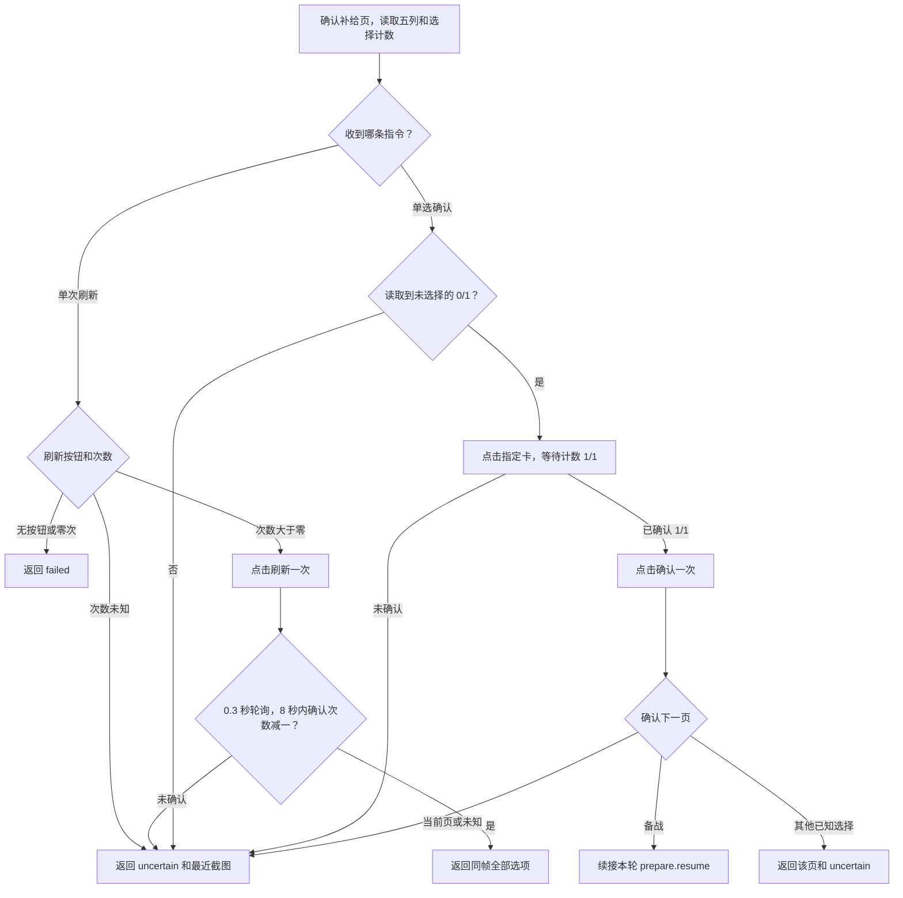

# 补给选择

依据用户 2026-11-16 提供的 1-5 补给截图与「刷新选项有时候没有」的说明，另取得 3-3 原始 1920×1080 画面并完成一次白厄选择。当前适配五列、单选补给。

## 命令

```powershell
.\.venv\Scripts\python.exe tools/cw.py observe
.\.venv\Scripts\python.exe tools/cw.py act supply --option 4
.\.venv\Scripts\python.exe tools/cw.py act supply-refresh
```

## 读取

以中央「补给阶段」标题识别，阈值 0.85（3-3 实机 0.889，备战与主角选择帧 0～0.196），先于备战布局判断；左上「备战阶段」区分不了此页。`prepare`、只读 `observe`、备战等待与后台补领都接入该页，命中后停止空白点击与收集。

从左到右返回 `option_1`～`option_5`，每项含 `character`、`equipment`、`trial`，另附 `selection.current/limit`、`can_refresh`、`refreshes_left` 与同帧截图。文字漏读保留已读内容并标 `unknown`，计数漏读为 `null`。

刷新是可选控件：没有按钮时 `can_refresh: false` 并省略次数；有按钮时读次数，漏读为 `null`。两种情况都不阻塞观察与选择。

## 刷新与单选确认



刷新后的名称可以相同。按钮消失时仍需核对次数变化。已有选中项和多选均返回现场，由 AI 处理。

3-3 实机：程序经 `0/1→1/1` 确认后进入 3-4，白厄在 `bench_4` 识别 0.918，天基轨道炮经截图确认到账（库存识别未返回该件）。刷新、试用角色落点与其他奖励情形待验证。
