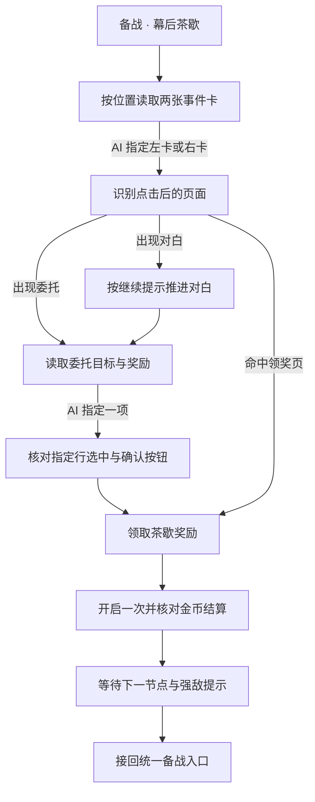

# 幕后茶歇

依据 `2026-11-21 16-47-00.mp4` 的 1920×1080 画面。录像从 2-6 的「幕后茶歇」入口开始，经不死狼委托和茶歇奖励，进入 2-7 备战。

`observe` 同帧读取入口、两项选择、对白、委托、领奖和结算。`prepare` 处理入口和可继续的固定步骤，到两项选择或委托列表时返回 `needs_ai: true`。茶歇界面及过场优先于普通备战。出战入口检查拒绝已知的茶歇动作，等待选择期间暂停普通备战及收集。

`act tea-break-choose --option 1|2` 按从左到右选择当前场次的事件卡。名称和说明直接从卡片读取，点击前核对茶歇标题和目标按钮轮廓。点击后按茶歇 HUD、对白继续提示、委托列表或领奖页识别去向。录像中的事件卡是「狼的诱惑」和「享用茶歇」，后者预览回复 20 点小队生命值。

`act tea-break-commission --option 1|2` 按从上到下选择委托，返回名称、目标和奖励，选中后仅点击该项内的「确认」。录像里的「跌跌撞撞Ⅱ」要求累计不完美通关 3 次，奖励 5 费聘用书 ×2。「完美连胜Ⅱ」要求连续完美通关 4 次，奖励经验 ×36。委托确认保留条件及后续奖励，茶歇金币另行核对。录像中未选择的事件和委托列表的「返回」待实机样例。

对白出现「点击空白处继续」时推进一次，等待新对白或委托列表。确认后以「领取茶歇奖励」和「开启」定位，只开启一次。结算读取各奖励项并与金币变化对账，录像为 72 → 85（基础奖励 5、利息 5、连胜 3）。此后等待下一节点，录像中棋盘先出现，再显示带继续提示的「强敌来袭」。关闭该提示或确认备战布局稳定后，交给统一入口处理主角和奖励。超时返回最近截图及可确认阶段，已经发出的点击不重发。
