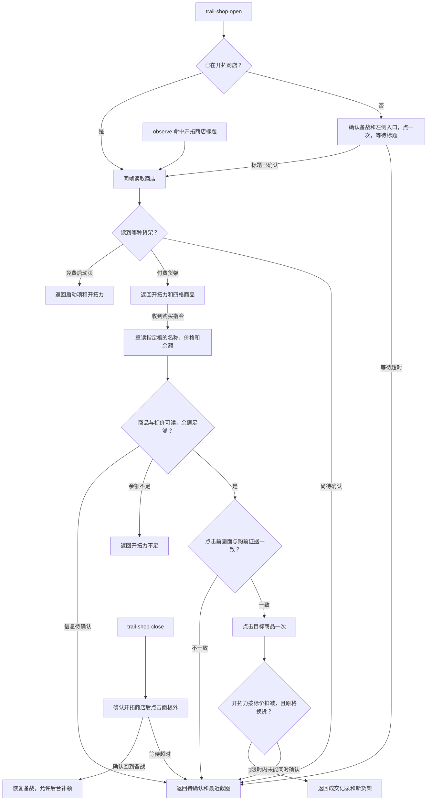

# 开拓商店

开拓商店使用开拓力。实机 3-7 备战画面中，入口在棋盘左侧，标签为「打开商店」。展开后标题写作「【开拓商店】」。左上角显示余额，中间商品从左到右编号 1 至 4，每格有名称、标价和「详情」。

## 观察与分流

`observe` 先确认标题，再读取开拓商店，返回 `screen: "开拓商店"`、`mode`、`trailblaze_power`、`offers` 和同帧截图。付费货架的四列用「详情」确认，至少匹配三列。每项包含 `slot`、`name`、`price` 和 `affordable`。名称栏局部放大 2 倍再 OCR，保留「Ⅱ」后缀和数字显示名。名称、价格或余额漏读时返回空值，保留已读出的字段并报告待确认。

免费启动页按「星穹列车」和标价 0 识别，返回 `mode: "launch"` 及启动项。付费购买指令要求付费货架已出现。免费启动页的识别参照[上游实现](https://github.com/moesnow/March7thAssistant/blob/6be8ddb54667041bc2c78d4987a7dcf71fcf14a4/tasks/weekly/currency_wars_ui.py#L1575-L1592)，待实机样例验证。

识别到开拓商店时，备战流程停在该页，后台补领等待商店关闭。左侧开拓商店和右下普通商店各有自己的入口与余额。

## 操作

| 命令 | 参数 |
|---|---|
| `act trail-shop-open` | 确认普通商店收起及左侧入口后执行 |
| `act trail-shop-buy --slot 3` | 商品槽从左至右为 1～4 |
| `act trail-shop-close` | 点击面板外的左上角，坐标参考上游，实机待确认 |

固定步骤使用有限等待，操作结果仍待确认时交回最近截图。识别浮窗标记入口、标题、开拓力和各格名称与价格。商品 OCR 的框按原截图坐标显示。

## 实机样例

3-7 在 111 开拓力时购买第 3 格「后台强度Ⅱ」，价格 30。购后余额为 81，原格变为「幸运一击率Ⅱ」。余额为 6 的画面中，四格价格是 30、40、30、50，价格显示为红色。另一个角色格的显示名为「23」。这些画面用于回放初始读取、成交和余额不足。
