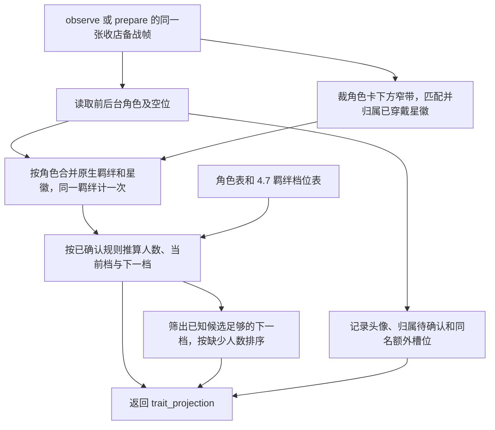
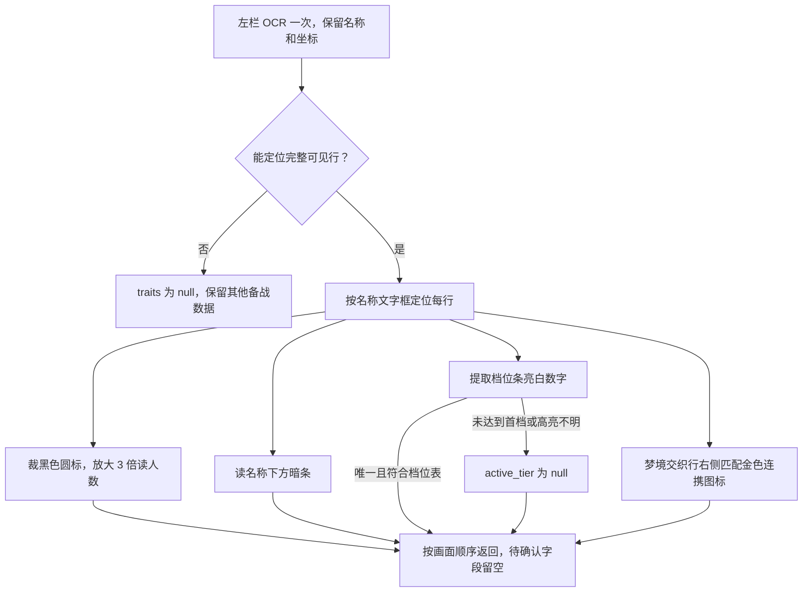

# 备战羁绊识别

## 根据阵容推算

阵容规划以规则表推算羁绊。[角色数据](../data/characters.json)的 `traits` 来自[角色图鉴整理](../资料/角色.md)，保存 59 名角色的原生羁绊。[羁绊档位表](../data/traits.json)以 [阵营羁绊](../资料/阵营羁绊.md)和[流派羁绊](../资料/流派羁绊.md)为依据，适用于 4.7「入画奇航」。星神★阿哈只有已确认的站位数据。角色表中的专属羁绊保留归属，资料缺少档位时不推算该项等级。

程序按前后台角色归组，备战席用于预演换人。



| 特殊规则 | 推算边界 |
|---|---|
| 幻月游戏 | 已知本局变体时用对应表。变体待确认时，只返回各变体一致的当前档与下一档 |
| 少女乐队 | 恰好 1 或 4 人。存在未知上阵位或同名额外卡时档位待确认 |
| 千星商会、专属羁绊 | 千星商会额外效果按上场三星成员分级。缺少计算条件时仅返回已知成员 |
| 同名角色、不同形态与位置 | 当前按不同名字各计一次。`duplicate_slots` 保留重复额外槽位，前后台条件和同名贡献待核对 |

星徽使用素材中央裁区，按图标中心确定角色槽位。分数和首选分差均需满足样例阈值，仅计入档位表中已确认的星徽。库存与备战席星徽独立观察。前台梦境交织星徽已初步验证，其他外观与素材仍待核对。通用已穿戴装备记录待接入。

`basis: "native_and_emblems"` 表示按原生羁绊与确认穿戴的星徽推算。`emblems` 保存上阵槽位与星徽 ID，`current` 保存参与槽位、已知人数和档位，`unresolved_slots` 保存头像或归属不明的上阵位。`combinations` 列出下一档、所差人数和可补位角色，已上阵者从候选中去除。从零起步的羁绊只列首档仅差一人的组合。候选不足的档位仍可见于 `current`。推算覆盖画面截断的羁绊，满员时由 AI 根据参与槽位选人替换。

`traits` 保留给画面可确认的状态。2-2 样例里，那刻夏穿上「梦境交织星徽」后成为共舞候选，羁绊人数在确认共舞前后都是 2。左侧金色图标仍用于确认共舞完成。

## 从备战画面读取

首版设计读取 1920×1080、商店收起的普通备战截图。`observe` 和 `prepare` 在返回备战局势时，从同一帧返回左侧完整可见的羁绊。顺序以当前画面为准。2-2 时「连击」在「小小巨人」上方，2-7 时两行互换。

## 识别步骤



坐标基于 1920×1080。名称 OCR 区域为 `(106, 229, 153, 538)`，样例行距约 84 像素。以首行 `y=235` 为例，人数取 `(83, y+38, 15, 24)` 的内部数字并用单行模式，暗条取 `(109, y+33, 111, 28)`。名称下方数字和右侧图标偶尔也会被 OCR 读到，按位置区分。原尺寸圆标试读会漏掉 `1` 或误读为 `0`。

2-7 的「追击」暗条 `1/3` 表示当前 1 人、首档 3 人，图鉴档位为 `3/5/7/10`。小小巨人、连击和梦境交织分别高亮 `4`、`4`、`2`。同一行的人数和档位在确认前后可以相同，连携通过金标独立核对。[梦境交织](dreamweave.md#左侧羁绊核对)

## 返回字段

`traits` 按从上到下排列。`count` 是圆标人数，`progress_text` 是人数旁暗条的文字，`tiers` 从已确认的图鉴档位表取得，`active_tier` 是画面读出的白色高亮数值。追击 `1/3` 属于已确认未激活，因此 `active_tier` 为 `null`。`linked` 只在已支持连携判据的羁绊上返回。字段待确认时填 `null`，其余字段照常保留。例取 2-7 截图前两行、梦境交织和追击。

```json
{
  "traits": [
    {"name": "小小巨人", "count": 4, "progress_text": "2/3/4/5/6", "tiers": [2, 3, 4, 5, 6], "active_tier": 4},
    {"name": "连击", "count": 4, "progress_text": "2/4/6/8", "tiers": [2, 4, 6, 8], "active_tier": 4},
    {"name": "梦境交织", "count": 2, "progress_text": "2/3/4/5", "tiers": [2, 3, 4, 5], "active_tier": 2, "linked": true},
    {"name": "追击", "count": 1, "progress_text": "1/3", "tiers": [3, 5, 7, 10], "active_tier": null}
  ]
}
```

底部只露出名字或图标的行不纳入本次结果。截图之外的羁绊状态未知，首版观察只读当前画面。2-7 的「开拓银轨」是截断行。当前样例未确认滚动方式和其他布局，取得画面后再扩展。若羁绊列表未能定位，`traits` 为 `null`，保留备战其他数据。

## 样例验证

用户提供的 2-7 截图及 2-2 共舞后录像帧保存在 `tools/.runtime/dreamweave-design/`。现有 OCR 试读两帧的 12 条完整可见行，名称、圆标人数和暗条文字均读对。亮白数字试读通过 2-7 的三个高亮档，录像压缩下的个别高亮仍待核对。识别流程和 CLI 字段尚未接入。
